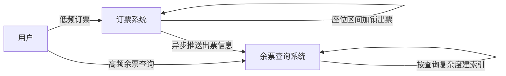
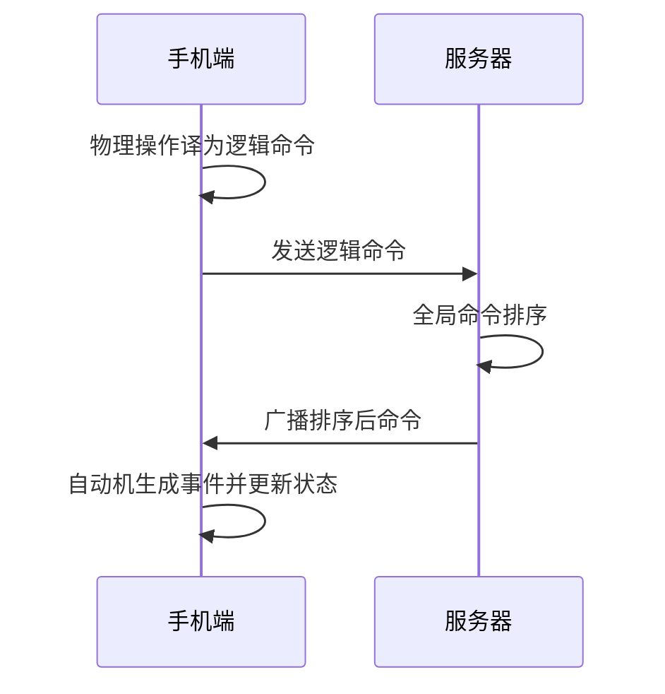

## 一句话总结

公布第 1 期两道主观题参考答案：春运卖票本质是 QPS 近 200 万、TPS 仅几百的"查询极重"业务，用 CQRS 读写分离加异步推送解决；王者荣耀用事件溯源，服务器只做命令排序、自动机与状态放手机端以省流量。核心结论是架构核心知识通用。

## 知识导图

- 架构案例拆解
  - 春运卖票
    - TPS仅几百到几千
    - QPS近200万
    - 定位查询极重业务
    - CQRS读写分离
    - 订票与查询两系统
    - 出票信息异步同步
    - 写端座位区间加锁
    - 锁粒度车次站点座位
    - 万级TPS内可承载
    - 读间无冲突可并发
    - 业务容忍查询不一致
    - 牺牲时效换吞吐
  - 王者荣耀
    - 物理操作转逻辑命令
    - 事件即已发生变更
    - 状态是角色与竞技场
    - 服务器全局命令排序
    - 自动机放手机端
    - 依据手机流量小
    - 时光机支持重连
    - 读模式节点供解说
    - 自动机须无随机性
    - 需跨平台浮点中间件

## 核心概念

- **CQRS（读写分离）**：把订票系统与余票查询系统拆成两个系统，出票信息由订票侧异步推送给查询侧。读、写各自独立优化，成立前提是业务不要求读写在同一事务中完成。
- **区间加锁**：出票前必须锁住同一车次连续几个站点的同一座位，防止已选票被抢走。把票拆到"车次×站点×座位"最细粒度后，写入退化为 1 万 TPS 以下的加锁问题，一般数据系统都能承受。
- **事件溯源三要素**：命令是外部指令（App 需把屏幕点击等物理操作翻译成"角色向右走"这类逻辑命令）；事件是已发生且会改变状态的事；状态是 10 个角色与竞技场的当前情况。
- **自动机确定性**：事件溯源的时光机、读模式节点等能力都建立在自动机无随机性的前提上。不同手机 CPU 浮点精度不同，需要跨平台浮点计算中间件抹平差异。

## 核心要点

1. 数据分析先行：日售票 1000 万张约 115 笔/秒，峰值 TPS 几百到几千；峰值 QPS 接近 200 万，约为淘宝订单 TPS 的 4 倍。
2. QPS 与 TPS 的优化架构完全不同、不可比，TPS 更难处理，量级低是正常现象。
3. 合并两组数据才能定位业务形态：查询量极其巨大、交易量正常——所以优化重点是查询侧，这对应课程第 7 课的 CQRS。
4. 写端数据量估算约 100T，一个机柜内存即可装下，数据量不是挑战，真正的写挑战是区间加锁。
5. 读操作可分布式化的依据一：任意两个读操作之间没有冲突，无冲突即可并发，一生二、二生万物，堆机器即可（对应第 19 课）。
6. 依据二：用户被抢票体验训练出"查得到但买不到"的默认容忍，业务接受查询与实际不一致，可异步推送、按需建索引，牺牲时效性换吞吐量。
7. 状态放服务器还是手机端取决于数据传输量：手机网络吞吐小，应把自动机放手机端、只传命令，事件生成与状态更新都在端上完成。
8. 服务器职责收敛为收集全部命令并排序（保证全局操作顺序），这继承了事件溯源的时光机（掉线重连）与读模式节点（解说员实时观战）。
9. 架构核心知识是通用的：复杂系统宏观上类似，细节各有千秋，关键是开发者如何合理使用。

## 架构与流程

## 关键对比

| 维度 | 春运卖票 | 王者荣耀 |
| --- | --- | --- |
| 主要瓶颈 | 读侧 QPS 近 200 万 | 弱网流量与多端状态同步 |
| 核心方案 | CQRS 读写分离 + 异步推送 | 事件溯源 + 命令排序 |
| 一致性容忍 | 查询结果允许与实际不一致 | 掉线重连后恢复到当前状态 |
| 优化抓手 | 牺牲时效性换吞吐量 | 减少传输数据量（传命令不传状态） |

## 易混与坑

- "查到票但买不到"不是错误，而是异步架构下的最终一致，是架构选型时的主动牺牲。
- 不要把点击量峰值当交易压力：TPS 只有几百到几千，压力全部在读侧。
- 游戏命令不能用屏幕坐标直接传输：机型与屏幕尺寸不同，物理坐标不通用，必须先翻译成逻辑命令。
- 自动机若含随机性，事件溯源的时光机等能力全部失效；浮点精度差异是隐蔽的随机性来源。
- 状态放手机端不是技术偏好，而是手机网络吞吐量约束下的数据量权衡。

## 自测问题

- 为什么春运卖票适合 CQRS 架构？（QPS 百万级而 TPS 仅几百，读写负载严重不对称且业务不要求读写同事务）
- 读操作分布式化的两条可行性依据是什么？（读与读之间无冲突可无限并发；业务默认容忍查询信息不一致）
- 游戏服务器为什么只做命令排序而不存状态？（手机网络吞吐小，传输命令比传输状态省流量，状态计算下沉到手机端）
- 事件溯源能力的前提是什么？（自动机必须无随机性，需用跨平台浮点计算中间件抹平不同 CPU 的精度差异）
