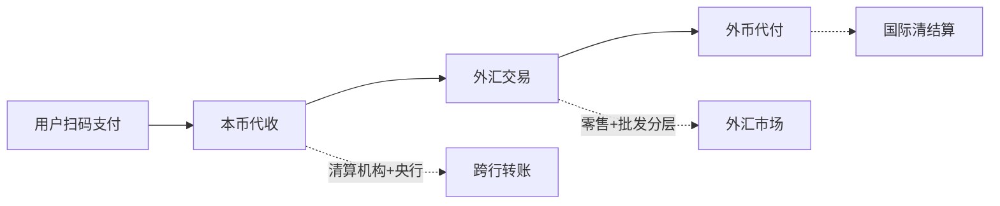
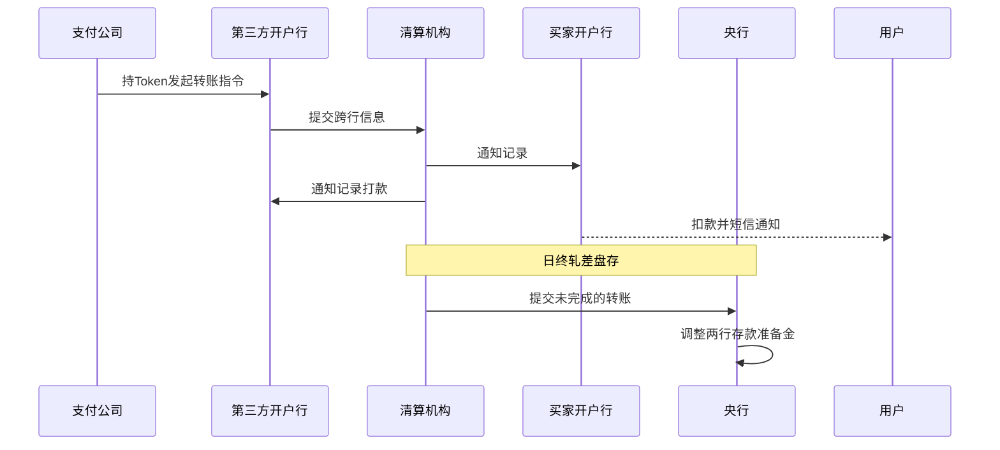

## 一句话总结
以跨境扫码支付为样本,拆解用户扫码后的完整链路(用户扫码→本币代收→外汇交易→外币代付),揭示支付业务背后的两大架构手法:异步消息处理与日终轧差。

## 知识导图
- 扫码支付
  - 为何选它入门
    - 最具代表性场景
    - 银行系机构全参与
    - 互联网与机构架构兼具
  - 用户扫码三步
    - 鉴权
      - 绑卡四要素
      - 短信动态验证
      - 银行返回Token
    - 支付
      - 二维码即订单
    - 拉取状态
      - 轮询查询
      - 异步削峰填谷
      - 推拉结合通知
  - 本币代收
    - 央行管真实资金
      - 存款准备金划转
    - 清算机构管记录
      - 日间只记账
      - 日终轧差结算
      - 七步转账流程
  - 外汇交易
    - C端零售
      - 双币种双账户
      - 四账号两笔订单
      - 时间与交易成本
      - 提前批量购汇
    - B端批发
      - 分层外汇市场
      - 订单逐层汇聚
      - 顶层做市商定价
      - 衍生品对冲风险
  - 外币代付
    - 走国际清结算
    - 原理同本币代收

## 核心概念
- **绑卡四要素**: 姓名、身份证号、银行卡号、银行预留手机号,全是银行记录的静态信息;再加短信验证码这一动态信息共验证 5 项。验证主体是银行,第三方公司只是转交,通过后拿到用户 Token 供后续合法操作。
- **轮询**: 用户 App 定时向支付后台查询交易状态。因为后台与银行之间是异步消息,支付结果不会同步返回,只能由用户主动拉取。
- **异步消息处理(削峰填谷)**: 应对偶发流量峰值的架构——高峰期把请求缓存进消息队列按系统正常速度消化,避免核心系统超载;代价是结果无法即时返回。
- **存款准备金**: 各银行存放在央行的资金。跨行转账不搬真钱,只需央行调整两家银行准备金的一减一增。
- **清算机构**: 记录日间全部跨行交易明细、日终计算各行净差额的机构,银联、网联、万事达均属此类。
- **轧差**: 把两家银行互欠金额相互抵消,日终只按净差额通过央行做一笔真实转账;本质是延时更大的批量异步处理。
- **外汇零售与批发**: 面向终端用户的小额换汇逐层向上汇聚成大额订单;顶层是巨型跨国商业银行做市商,通过交换不同币种的大额定息存折决定汇率。

## 核心要点
1. 扫码跨境支付链路四段:用户扫码、第三方本币代收、外汇交易、外币代付。
2. 鉴权验证 5 个信息:4 静态要素 + 1 动态短信码,验证方是银行。
3. 二维码本质是图形化的交易订单字符串。
4. 支付"确认"只代表后台收到请求,不代表支付成功,因此必须轮询。
5. 服务器实时推送 + 用户定时轮询,推拉结合是异步系统的标准状态通知方式。
6. 跨行转账日间只记账,日终由清算机构轧差、央行调准备金完成真实划转。
7. 账务原理要求一个账号只处理一个币种,一笔外汇购买涉及 4 个账号、2 笔支付订单。
8. 外汇有时间和交易(按次收费)两类成本,第三方公司倾向提前大批量购汇,储备降到警戒线再补。
9. 隔天到账期内的汇率波动属市场风险,常用期货、期权等衍生品对冲。
10. 外币代付与本币代收原理相同,只是币种变为美元、走国际清结算体系。

## 架构与流程
跨境支付四阶段总览:

跨行转账七步(简化为关键交互):

## 关键对比
| 维度 | C端外汇零售 | B端外汇批发 |
| --- | --- | --- |
| 参与方 | 第三方支付公司、有资质银行 | 银行、投行、跨国做市商 |
| 单笔规模 | 小额、面向用户 | 日均数万亿美元级 |
| 定价方式 | 汇兑提供行报价 | 做市商间交换大额定息存折 |
| 组织形态 | 无交易所、有资质门槛 | 有层级的跨国市场 |

## 易混与坑
- 绑卡在第三方 App 上完成,但真正的验证方是银行;第三方只持 Token 发起操作。
- 日终前买家开户行账面上减少的钱并未实际到达对方,实质资金要等央行调准备金。
- 清算机构与央行分工不同:清算管记录与轧差,央行管真实资金划转。
- 轧差是"延时更大的异步",不是实时清算;它牺牲时效换取流量与成本。
- 外汇账户必须按币种分离,一个账号只服务一个币种,所以一笔兑换变成两笔订单。

## 自测问题
- 为什么扫码后 App 需要轮询支付状态?(后台与银行间是异步消息,结果非同步返回)
- 跨行转账中清算机构与央行各做什么?(清算记录日间交易并日终轧差;央行调准备金完成真实划转)
- 一笔外汇购买为何是 4 个账号 2 笔订单?(双方各有本、外币两个账号,本币与外币各一笔支付)
- 外汇市场顶层是谁、如何定价?(跨国商业银行做市商,交换不同币种大额定息存折)
- 第三方公司如何摊薄外汇成本?(提前批量购汇+降到警戒线再补,减少按次收费与到账等待)
