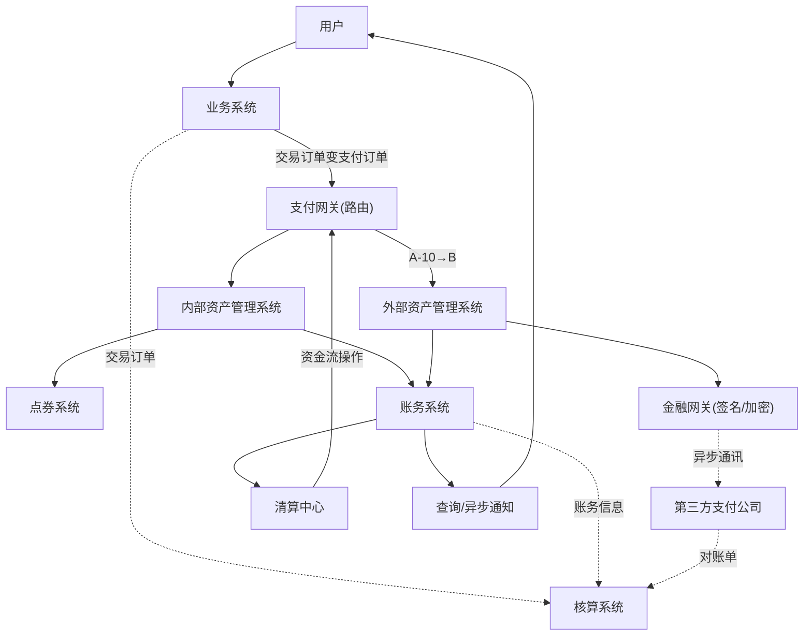

## 一句话总结
支付系统的第一性原理是"信息流与资金流分离",由此可推导出从点券系统到电商支付系统再到第三方支付公司的架构演进:账务、网关、核算、资金池、清算中心等组件逐一补齐。

## 知识导图
- 支付系统原理
  - 核心原理
    - 信息流与资金流
      - 信息流即使用权转移
      - 资金流即所有权转移
      - 最终必须同步
    - 为何选择分离
      - 实时清结算成本过高
      - 需全行业协同改造
    - 三条架构推论
      - 非银行方只产信息流
      - 异步最终一致
      - 需核算系统对账
  - 点券系统
    - 信息流等于资金流
    - 业务系统出订单
    - 支付网关处理
    - 账务系统管账户
    - 查询与通知系统
  - 电商支付系统
    - 外部资产走第三方
    - 路由分发内外资产
    - 金融网关协议对接
    - 调用轮询对账三步
    - 核算系统保一致
  - 第三方支付系统
    - 流量支持
      - 异步消息削峰
      - 熔断降级
      - 缓存分库分表
    - 备付金资金池
      - 虚拟账户记台账
      - 多银行多资金池
      - 跨行变行内省成本
    - 清算中心
      - 资金池间轧差
      - 监管演进调整架构

## 核心概念
- **信息流**: 想象中钱的流转,转移的是资金使用权(白天朋友间纸条记账);非银行机构没有物理现金,只能产生信息流。
- **资金流**: 钱的真实流转,转移的是所有权(晚上通过银行转账);只有银行和央行能完成。
- **交易订单/支付订单**: 交易订单同时含财产交换与物品交换两类信息;支付订单只记账号间的财产变动,是支付系统真正处理的对象。
- **金融网关**: 对接第三方支付/银行的二进制协议层,负责证书签名、加解密、协议传输与数据校验。
- **智能路由**: 金融网关对接多家支付机构,按可用性与费率动态选择通道。
- **核算系统**: 负责与第三方机构对账,并核对账务系统与业务系统的一致性,保证信息流与资金流最终同步。
- **备付金资金池**: 把用户资金混存于支付公司银行账户,账面用虚拟账户区分你我;须持支付牌照设立,挪用受严格监管。

## 核心要点
1. 信息流与资金流可分离、通常分离、最终必须同步;实时一致因成本过高暂不可行。
2. 分离的直接推论:支付系统本质是异步系统,一致性模型是最终一致性。
3. 电商公司与第三方支付公司都只处理信息流,真实资金流在银行体系内。
4. 点券等内部资产可内部闭环;银行卡等外部资产必须经第三方支付公司转银行处理。
5. 同步系统演进为异步系统的三步法:异步调用→限时轮询→日终对账。
6. 异步接口除成功、失败外还有不确定状态,轮询与对账就是为收敛它而存在。
7. 点券系统的三个基础组件:业务系统、支付网关、账务系统;再加查询与异步通知系统。
8. 高并发治理复用互联网方案:异步消息、熔断降级、缓存、分库分表。
9. 在多家银行设资金池,把跨行转账变成行内转账:省手续费,跨境可近实时到账。
10. 第三方支付公司内部清算中心对资金池间转账做清结算;国内备付金已 100% 集中存管,跨行资金池成历史,但清算中心组件保留。
11. 监管条例持续演进(如欧盟 GDPR),支付架构必须随监管因地制宜。

## 架构与流程
C 端支付核心组件关系(收单→清算→账务→对账闭环):

## 关键对比
| 维度 | 点券系统 | 电商支付系统 | 第三方支付系统 |
| --- | --- | --- | --- |
| 信息流/资金流 | 一致 | 分离 | 分离 |
| 资产性质 | 内部资产 | 外部资产(银行卡) | 外部资产+自有资金池 |
| 通讯方式 | 同步 | 异步(轮询+对账) | 异步+高并发治理 |
| 特有组件 | 账务/查询/通知 | 路由/金融网关/核算 | 资金池/清算中心/流量治理 |

## 易混与坑
- "支付"不等于"转账":第三方支付公司不能自己搬钱,只能记信息流再与银行同步。
- 不确定状态不是成功也不是失败,是异步通讯的必然产物,靠轮询+对账收敛。
- 账务系统负责记账,核算系统负责验证记账与事实一致,两者职责不能混。
- 资金池里钱不分你我,靠账本(虚拟账户)区分;账实分离正是监管重点。
- 备付金集中存管后国内已无资金池玩法,但该架构在跨境与海外仍有技术输出价值。
- 很多组件(如核算系统)平时看似多余,其价值在出错时体现——正确性建立在证据之上。

## 自测问题
- 为什么支付环节的非银行参与者只能产生信息流?(物理现金都在银行,它们只能记账)
- 处理异步不确定状态的两步是什么?(规定时间内轮询,失败则日终对账)
- 交易订单与支付订单的差别是什么?(前者含物品交换,后者只含财产交换)
- 多银行资金池为何能降低跨境成本?(跨行转账变多个行内转账,近实时到账且免跨行费)
- 第三方支付为什么需要自己的清算中心?(资金池间转账等价于跨行转账,需轧差清结算)
