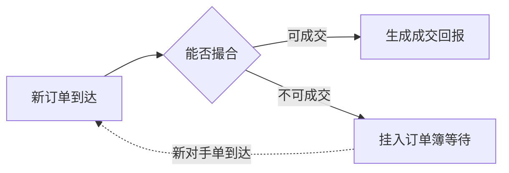

## 一句话总结
金融盈利的根本是利用信息不对称;信贷、资产证券化、场内交易、场外交易制造或消除不对称的方式不同,对应系统要求从批处理、海量分布式计算到微秒级低延迟逐级升级。

## 知识导图
- 金融业务与技术
  - 盈利原理
    - 利用信息不对称
  - 信贷类业务
    - 传统信贷
      - 低息吸储高息放贷
      - 信用评级防违约
      - 早期靠信贷员
      - 大数据改变格局
      - 批处理即可满足
    - 资产证券化
      - 打包拆分增价值
      - 违约率是概率
      - 违约间强相关
      - 定价公式复杂
      - 暴力求解算力大
  - 交易类业务
    - 场内交易
      - 交易所侧
        - 二级市场发现价格
        - 撮合买卖订单
        - 每时每刻秒杀
        - FPGA硬件实现
      - 用户侧
        - 投行拆单造不对称
        - 算法交易平台
        - 高频消除不对称
        - 低延时看统计规律
        - 猫鼠速度竞赛
      - 用户技术
        - 毫秒至微秒延时
        - C为主核心用汇编
        - 单进程免网络
        - 托管交易所机房
    - 场外交易
      - 产品类型广泛
      - 无市场自动定价
      - 必须主动定价
      - 复杂度与数据量
      - 统一定价平台靠DDD

## 核心概念
- **信息不对称**: 金融最核心的盈利原理;有的机构靠制造不对称赚钱(拆单),有的靠消除不对称赚钱(高频交易、公开市场)。
- **资产证券化**: 把房贷、消费贷等资产打包后按信用评级拆分成小包卖给投资人,分拆包装后总价值反而上升;次贷危机与花呗/借呗等背后都是这套资本运作。
- **一级/二级市场**: 一级是股东间私下交易,投行靠人脉撮合买卖,对系统要求不高;二级是交易所公开交易,靠海量成交发现合理价格,对系统要求极高。
- **拆单**: 把大额订单拆成小单分时发送以免冲击市场价格,本质是制造信息不对称;承载方是算法交易平台。
- **高频交易**: 以极低延时发现并利用他人的交易意图(如拆单后的连续小单),靠统计规律超短线获利。
- **场外交易(OTC)**: 交易所之外的交易,涵盖私下股票交易、外汇、证券化产品;没有公开市场发现价格,必须主动计算合同价值。

## 核心要点
1. 传统信贷靠利息差赚钱,信息系统只需结果正确,对时效与吞吐无要求,批处理即可。
2. 互联网+大数据让信用评级更快、更全、更便宜,信贷核心竞争力转向数据收集与处理。
3. 信用分是提前批量算好的评级结果,用于营造"实时放款"的体验。
4. 资产证券化定价两大挑战:公式复杂(正确性难保证)与数据量大(需上万台机器暴力求解)。
5. 区域性房贷违约意味着违约率之间强相关,这是次贷危机的概率学根源。
6. 股票交易所是永不停止的秒杀系统:极低延时+极高吞吐量,靠 FPGA 等硬件实现;业务逻辑简单但不怕研发成本高、周期长。
7. 交易所撮合逻辑直白:维护未成交买卖订单簿,新订单能配则配、不能配则排队。
8. 交易所用户侧是猫鼠游戏:投行拆单制造不对称,对冲基金高频消除不对称,谁快谁赚钱。
9. 低延时决定技术栈:C 首选、核心代码用汇编、单进程完成全部逻辑、机器托管在交易所机房。
10. 互联网方案(分库分表、缓存、最终一致)都以牺牲延时换流量,交易所场景完全不适用。
11. 场外交易占金融市场绝大部分;产品虽多但都与钱相关,共性可用领域驱动设计抽象出统一定价平台。
12. 支付属于 C 端金融,不适用场内/场外的 B 端划分。

## 架构与流程
交易所撮合引擎的简单直白逻辑:

## 关键对比
| 业务 | 核心竞争力 | 信息系统要求 |
| --- | --- | --- |
| 传统信贷 | 数据收集与评级 | 批处理、无实时组件 |
| 资产证券化 | 复杂定价能力 | 计算正确性+海量算力 |
| 交易所 | 速度与吞吐 | FPGA硬件、微秒级 |
| 交易所用户 | 延时优势 | C/汇编、单进程、托管机房 |
| 场外交易 | 产品抽象与定价 | 统一定价平台(DDD) |

## 易混与坑
- 一级市场靠人脉不靠技术,但上市定价仍需二级市场公开交易来发现价格。
- 不要把互联网高并发方案照搬到交易所:它们省流量费的正是交易所最不能牺牲的延时。
- 高频交易赚的是低延时下的统计规律(如发现小买单后抢跑),不是宏观基本面判断。
- 外汇没有交易所,属于场外交易;资产证券化产品同样属于场外。
- 拆单与高频是同一枚硬币的两面:一个制造不对称,一个消除不对称。
- 资产证券化"分拆增价值"不是魔术,而是把风险重新分配并转移给了投资人。

## 自测问题
- 金融业最核心的盈利原理是什么?(利用信息不对称)
- 资产证券化定价对系统的两大挑战是什么?(公式复杂导致的正确性问题与暴力求解的海量算力)
- 为什么说交易所是秒杀系统?(每时每刻都有撮合,要求极低延时与极高吞吐量)
- 交易所用户为何选 C/汇编与单进程架构?(毫秒到微秒延时,消除语言与网络开销)
- 场外产品定价为何需要领域驱动设计?(产品类型繁多但有共性,需抽象出统一定价平台)
