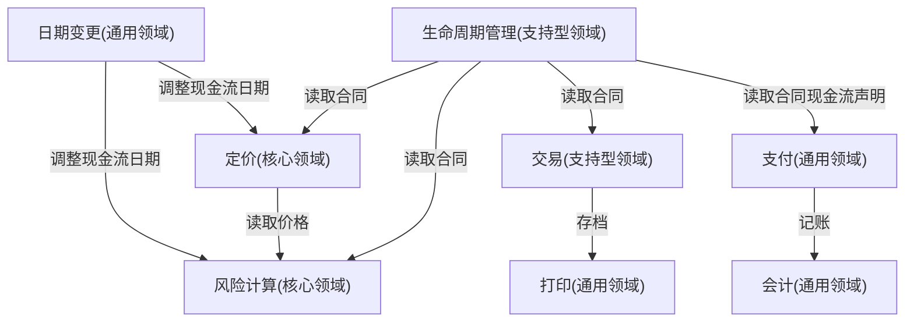

## 一句话总结
领域驱动设计是面向复杂金融软件的战略方法论:先以小组直接沟通解决"人"的问题并沉淀领域语言,再按核心/通用/支持型三类领域分配资源,两大约束是投资回报比与长期优化。

## 知识导图
- 领域驱动设计
  - 定位
    - 战略而非战术
    - 只解决复杂问题
    - 注重投资回报比
    - 着眼长期优化
  - 适用条件
    - 组件足够多
    - 业务逻辑复杂
    - 生命周期长
  - 人员组织
    - 传统层级沟通
      - 四步瀑布流程
      - 层层翻译致信息损失
    - 小组直接沟通
      - 全员参与
      - 决策速度提升
      - 打破部门壁垒
      - 沉淀领域语言
      - 弱化产品经理
  - 系统组织
    - 核心领域
      - 判断看竞争优势
      - 看超额利润
      - 自研加最优人手
      - 审时度势演进
    - 通用领域
      - 跨行业通用
      - 优先采购
      - 次选二开外包
      - 能用即可随换
    - 支持型领域
      - 辅助核心领域
      - 仅行业内通用
      - 买人工自研递进
  - 实战案例
    - 衍生品管理系统
      - 投前定价交易打印
      - 投后支付会计风控
      - 定价风控属核心
      - 打印支付会计通用
      - 交易报价属支持型

## 核心概念
- **领域驱动设计(DDD)**: 针对特定领域定制的战略设计,空间上覆盖整个行业领域,时间上覆盖软件全生命周期,角色上覆盖业务、产品、开发、运维全员;专门用于复杂问题。
- **领域语言**: 全员直接沟通中沉淀出的对专业术语的共同理解,让各方沟通不再"鸡同鸭讲"。
- **核心领域**: 能给公司带来行业内竞争优势的业务;判据是超额利润(超出行业平均水平的利润),且随时代与竞争对手漂移。
- **通用领域**: 跨行业可用的能力(短信、安全、日志、存储),市场多有成熟产品,优先采购。
- **支持型领域**: 辅助核心领域运转、不能跨行业通用(会计系统、市场数据系统),缺了不行但不是竞争力。

## 核心要点
1. DDD 是战略思路而非战术实操;简单问题不要用,金融软件恰好满足组件多、逻辑复杂、生命周期长三个条件。
2. 两大务实原则:注重投资回报比、做长期优化。
3. 层级沟通的每一步都是翻译,流程越长信息损失越大;最优沟通是单层级的小组直接沟通。
4. 金融系统可能运行几十年,远超个人项目周期,长期沟通成本决定项目成败。
5. 直接沟通带来三个文化变化:决策更快、打破部门壁垒、弱化产品经理角色。
6. 金融术语生僻(融资融券、内保外贷、DCF、Snowball 等),正确建模的前提是正确理解术语。
7. 在金融行业,开发人员往往是最懂业务的人——写程序必须穷尽正常与异常分支。
8. 核心领域自研、配最好的人手、做长期投入;核心竞争力买不来。
9. 核心领域会漂移:70 年代是电算化处理交易,08 年前后是风险计算与对冲,需审时度势。
10. 同一组件在不同公司重要性不同:会计系统对券商是支持型,对会计服务公司是核心。
11. 通用领域优先采购;二开不行也只投非核心力量,按随时可替换设计,质量要求"能用就行"。
12. 支持型领域三步走:先买→再人工处理(办公软件亦可)→最后低耦合自研。

## 架构与流程
三类领域的划分决策与资源策略(DDD 顶层分层思路):

## 关键对比
| 维度 | 核心领域 | 通用领域 | 支持型领域 |
| --- | --- | --- | --- |
| 判断标准 | 带来超额利润 | 跨行业通用 | 辅助核心、不跨行业 |
| 典型例子 | 定价、风险计算 | 短信、支付、会计、日期 | 交易、报价、生命周期管理 |
| 通用范围 | 公司特有、随时代漂移 | 全行业 | 金融行业内 |
| 资源策略 | 自研+核心人手 | 采购优先、外包可接受 | 买→人工→简单自研 |
| 质量要求 | 持续升级投入 | 能用就行、随时可替换 | 能用就行、与核心低耦合 |

## 易混与坑
- "重要"不等于"核心":短信通知坏了也是大事,但只有带来超额利润的才是核心领域。
- 核心领域是动态的:曾经的电算化、风险计算一旦被同行复制就失去核心地位。
- 支持型领域与通用领域的分界线是"能否跨行业",不是"是否重要"。
- DDD 耗时耗力,投入前先算 ROI,小而简单的系统用了得不偿失。
- 层级沟通看似规范,实则每一层翻译都在丢信息,是复杂项目失败的常见根源。

## 自测问题
- 判断核心领域的根本标准是什么?(能否带来行业内竞争优势,即超额利润)
- DDD 为什么要求小组直接沟通?(层级沟通层层翻译损失信息,单层沟通损失最小)
- 通用领域的资源策略优先级如何排?(采购>二次开发>外包/非核心自研,按可替换设计)
- 衍生品管理系统中哪些组件属于支持型领域?(交易、报价、生命周期管理)
- 为什么大型金融公司很少设产品经理岗?(开发人员在穷尽业务分支中最懂业务,直接沟通弱化翻译层)
