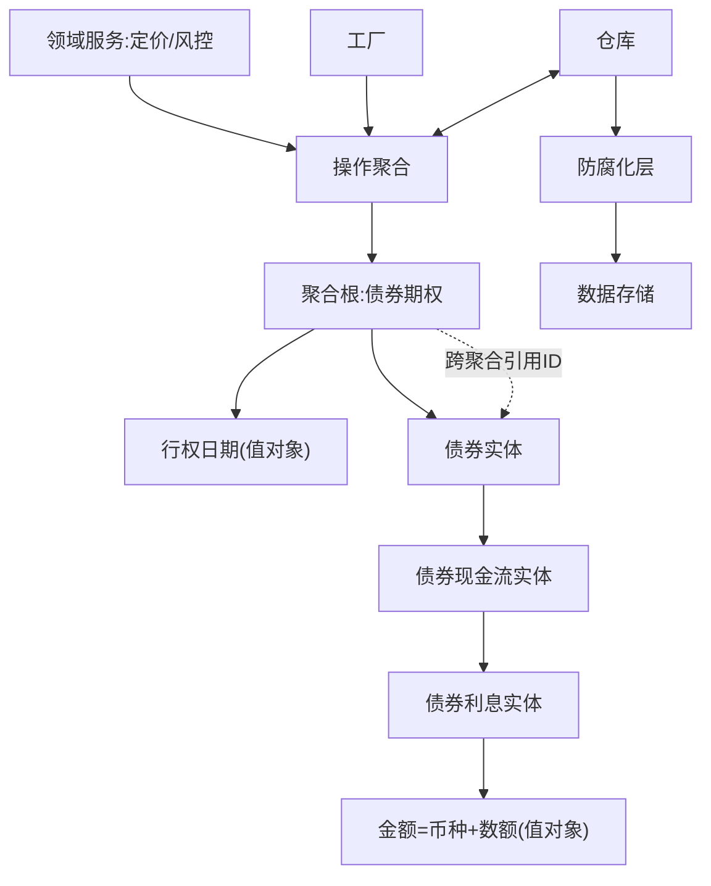

## 一句话总结
以债券期权为例讲解 DDD 统一业务模型:建模逻辑三要素(实体、值对象、领域服务)+生命周期管理三组件(聚合、工厂、仓库);聚合定义影响与存储双重边界,仓库兼任防腐化层。

## 知识导图
- 统一金融模型
  - 业务案例
    - 债券期权
      - 行权权利与定价
      - 输入未来现金流
      - 输入历史与市场数据
      - 欧式看涨的简化
  - 建模逻辑
    - 实体
      - 唯一标识符
      - 标识判同一
      - 生命周期管理
      - 例债券期权现金流
    - 值对象
      - 无唯一标识
      - 内部属性判等
      - 不可变修改即替换
      - 实体的附属品
      - 例金额与行权日
    - 领域服务
      - 承载跨实体逻辑
      - 无状态无随机
      - 不可变架构
      - 例定价与风控
  - 生命周期管理
    - 聚合
      - 影响范围边界
      - 聚合根唯一入口
      - 一个数据库事务
      - 有向无环小图
      - 大图用延时加载
      - 跨聚合存引用ID
      - 多聚合最终一致
    - 工厂
      - 创建与使用分离
    - 仓库
      - 业务对象存取
      - 兼任防腐化层
      - 不做数据分析

## 核心概念
- **实体**: 有唯一标识符的业务对象,靠标识判断是否同一,从发行到到期有完整生命周期;债券、期权、现金流、利息都是实体。
- **值对象**: 只有值没有标识的对象,靠内部属性判等(金额=币种+数额);不可变,修改即替换;只能作为实体或值对象的附属属性(状态)存在。
- **领域服务**: 业务逻辑跨多个实体、不适合放进任何单个实体时的逻辑载体;金融领域要求无状态、无随机性,因此金融系统普遍采用不可变架构。
- **聚合**: 实体引用关系图中的一个子图,同时定义影响范围边界与存储边界(一个数据库事务);聚合根是唯一入口且必为实体。
- **工厂**: 负责业务对象的创建,与设计模式中的工厂作用一致,实现创建与使用分离。
- **仓库**: 负责业务对象的序列化存取;形态像 SOA 的数据访问层,但更关键的作用是防腐化层——隔离数据使用与数据存储,防外部协议变化入侵领域模型。
- **防腐化层**: 介于新旧系统之间,把老协议包装成新协议;外部变化入侵内部导致架构变差的过程即"腐化"。

## 核心要点
1. 实体三特征:有唯一标识符、靠标识判同一、有生命周期管理。
2. 值对象五特征:无标识、有内部属性、内容判等、不可变(修改返回新对象)、不能独立存在。
3. 实体与值对象的划分取决于具体问题:数钞票时人民币是值对象,验真伪时看编号就成实体。
4. 值对象只能顺藤摸瓜通过引用关系访问,修改即整体替换,故建议属性全只读。
5. 领域服务不依附任何实体、独立存在;定价与风险计算是典型领域服务。
6. 金融计算要求无状态、无随机性——这是金融系统普遍采用不可变架构的根源。
7. 聚合设计三原则:关系呈有向无环图、图尽量小(事务小、存取快)、太大用延时加载摊销。
8. 聚合间访问只能通过聚合根;可将对方聚合根的唯一标识符作为值对象存储引用。
9. 单个聚合用数据库事务保证一致性;多个聚合放弃大事务,改用最终一致性,须提前设计中途不一致的处理。
10. 业务对象创建归工厂、使用归领域服务。
11. 不建议用仓库做数据分析,DDD 有专门的事件溯源与 CQRS。

## 架构与流程
DDD 建模组件与分层关系(以债券期权聚合为例):

## 关键对比
| 维度 | 实体 | 值对象 | 领域服务 |
| --- | --- | --- | --- |
| 标识 | 有唯一标识 | 无 | 无 |
| 判等方式 | 按标识符 | 按内部属性 | 不涉及 |
| 生命周期 | 有(发行至到期) | 无 | 独立存在 |
| 状态 | 有状态 | 不可变 | 无状态 |
| 例子 | 债券、期权、利息 | 金额、行权日、市场利率 | 定价、风险计算 |

| 维度 | 聚合内 | 聚合间 |
| --- | --- | --- |
| 访问方式 | 仅经聚合根 | 引用对方聚合根唯一标识符 |
| 存储保证 | 一个数据库事务 | 放弃大事务、最终一致 |

## 易混与坑
- 实体/值对象不是固定标签:同一对象随问题定义可互相转换,需具体情况具体判断。
- 值对象不是"简单的值":金额是币种+数额的复合体,判等必须整体比较而非逐字段随意比。
- 聚合不只是影响边界,同时是存储(事务)边界;聚合过大事务就慢,要用延时加载。
- 跨聚合引用存的是聚合根的唯一标识符,不是对方实体本身。
- 仓库与数据访问层的本质区别是防腐化职责:外部存储协议变化不应入侵领域模型。
- 不要用一个更大的事务包住多个聚合事务:事务范围过大且不确定,存储效率低。
- 聚合图关系应尽量构成有向无环图,避免环状引用导致一致性问题。

## 自测问题
- 实体与值对象最根本的区别是什么?(有无唯一标识符,以及据此决定判等方式)
- 为什么金融领域服务必须无状态、无随机?(正确性要求极高,排除不确定性,故金融系统普遍不可变架构)
- 聚合定义了哪两类边界?(影响范围边界与数据库事务存储边界)
- 聚合的关系图太大怎么办?(延时访问 Lazy Loading,访问到才加载,摊销加载时间)
- 仓库为什么被视为防腐化层?(隔离数据使用与存储,防止外部协议变化入侵内部模型)
