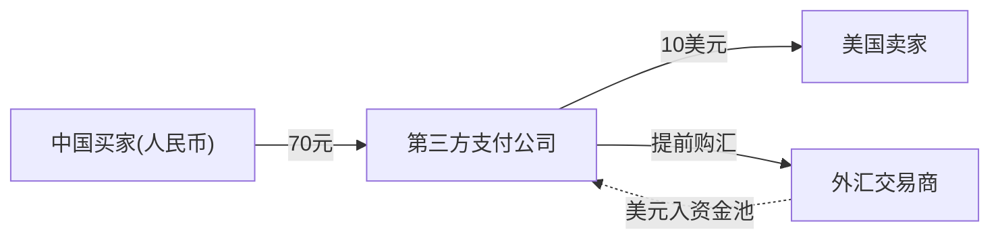
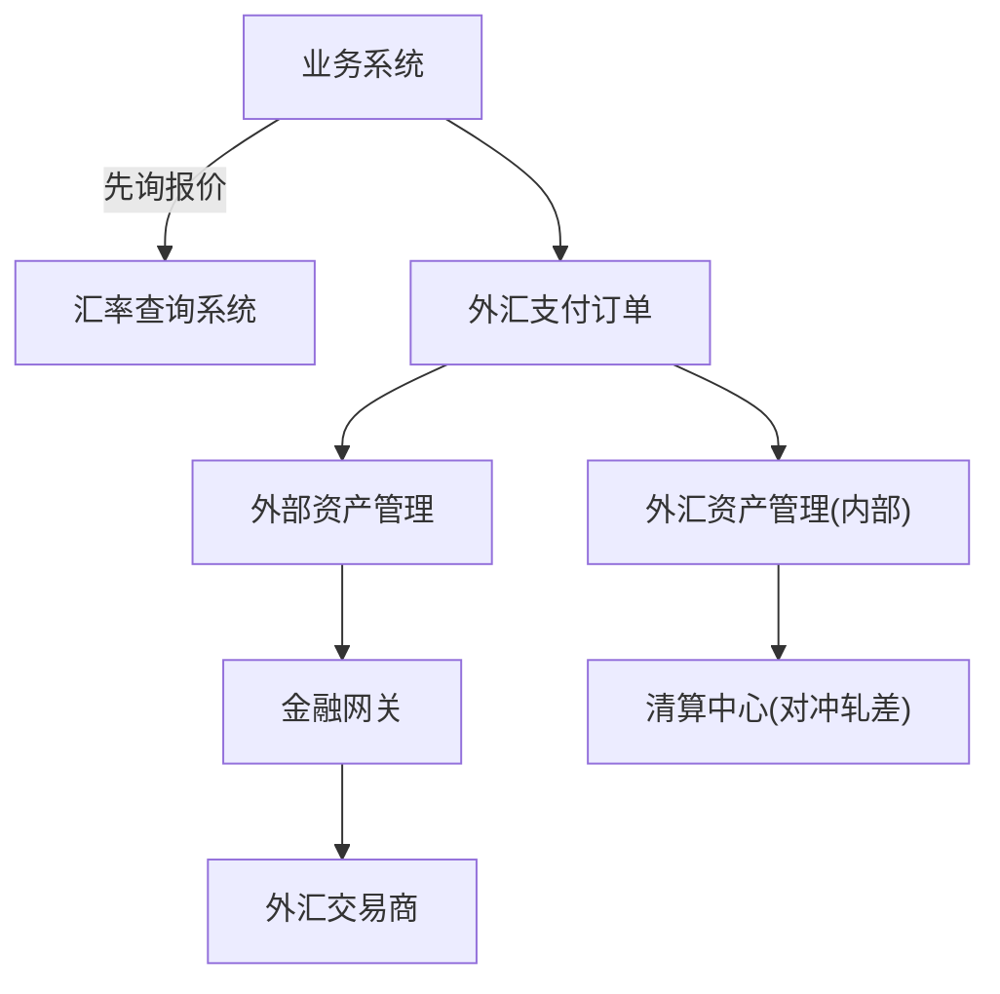

## 一句话总结
集中解析模块一前五讲思考题(降低汇兑成本、外汇支付架构、监管规避、领域间数据传输、行权通知),并拓展完整外汇系统架构:汇率查询、清算中心对冲省费与司库预测购汇。

## 知识导图
- 答疑与外汇拓展
  - 思考题解析
    - 降低汇兑成本
      - 第一步代理交易
      - 收集交易行为数据
      - 第二步自营资金池
      - 分币种垫资建池
      - 轧差减少交易次数
      - 预测流动性风险
    - 外汇支付架构
      - 一笔外汇两笔订单
      - 记录汇率与手续费
      - 独立外汇系统
      - 外汇资产似点券
    - 监管规避
      - 拆解吸储放贷条件
      - 存款转公司股份
    - 领域间数据传输
      - 小公司用简单类型
      - POJO缺校验行为
      - 大公司用领域模型
      - 金融重正确性
    - 行权自动通知
      - 属领域服务
      - 操作行权日期值对象
      - 通知用通用领域
  - 外汇系统架构
    - 四主体资金流
    - 复用支付系统组件
    - 新增汇率查询
    - 清算中心对冲省费
    - 司库预测购汇量
  - 出题思路
    - 业务驱动系统演进

## 核心概念
- **垫资(Floating)**: 公司在每个币种资金池中放入自有资金,把外汇交易分解为单币种收支,无需逐笔实时换汇。
- **外汇支付=两笔同币种交易**: 买家人民币付给支付公司、支付公司美元付给卖家;关键是把两笔不同币种的支付订单关联,记录当时汇率与手续费便于日后对账。
- **司库(Treasury)**: 企业资金管理部门,根据未来几天的外汇支付行为预测需要购换汇的金额。
- **POJO 的缺陷**: 纯二进制数据形态缺乏对象行为,最缺的是逻辑校验能力,使用方必须重建全部业务验证逻辑,易出错。

## 核心要点
1. 降低汇兑成本两步走:先代理每笔交易赚手续费并收集用户交易行为,再自营建分币种资金池。
2. 自营模式下用自有清结算能力轧差,把双向交易抵消,大幅减少与中间商的按笔收费。
3. 自营的风险是单向交易过多致资金池枯竭,需财务提前预测流动性、提前购汇,来不及再回退代理模式。
4. 外汇支付在架构上按"没有外汇"处理:两笔不同币种支付订单+关联关系(汇率、手续费)。
5. 实践中独立外汇系统承担购汇、对接汇兑提供行与外汇资产管理;外汇资产管理可视为另一种点券系统(点券换成各国货币)。
6. 业务系统需先向外汇报价接口,再生成外汇支付订单。
7. 规避"银行"定性只需拆掉吸储或放贷任一条件;存款转公司股份的漏洞很快被监管堵住。
8. 领域间传输类型因公司规模取舍:小公司求上线快用简单数据类型+数据库互通;大公司求正确用领域模型。
9. 金融公司对正确性要求极高,倾向初期就用领域模型;向领域模型切换存在双轨过渡的维护成本。
10. 行权自动通知跨多个实体,定位为领域服务;其操作对象是行权日期(值对象),通知依托消息系统(通用领域)。
11. 外汇系统大量复用第三方支付组件(账务、金融网关、资产管理、核算),购换汇走外部资产管理,金融网关改对接外汇交易商。
12. 外汇系统新增汇率查询系统,为跨境电商支付页面提供可交易汇率。
13. 清算中心把双向外汇交易(中国买美国货、美国买中国货)对冲,减少资金流笔数节省交易成本。
14. 思考题的共同出发点:金融业务不断追逐高利润新点,系统必须学会持续升级。

## 架构与流程
外汇支付四主体的资金流:

外汇系统组件(复用支付组件+新增汇率查询):

## 关键对比
| 维度 | 汇兑代理模式 | 汇兑自营模式 |
| --- | --- | --- |
| 交易方式 | 每笔交中间商处理 | 资金池内单币种轧差 |
| 成本结构 | 按笔付手续费 | 垫资占用+偶发补货购汇 |
| 前提条件 | 无 | 交易行为数据+流动性预测 |
| 回退能力 | - | 可随时回退代理模式 |

## 易混与坑
- 外汇支付不是"先换汇再付款",而是两笔独立同币种订单,外汇只是两者的关联信息。
- 外汇资产管理系统的本质是点券系统的变体,不要为新名词重新造轮子。
- POJO 跨领域传输省的是眼前功夫,丢的是校验行为,大公司反编译业务行为极易出错。
- 大公司从小数据类型切换到领域模型有双轨期,短期维护成本上升,是领导层的长期 ROI 决策。
- 存款转股份式监管套利不可持续,监管会迅速补漏洞。

## 自测问题
- 自营外汇靠什么降低按笔收费?(分币种资金池垫资+轧差抵消双向交易,减少与中间商交易次数)
- 外汇支付订单应如何设计?(两笔不同币种支付订单,以关联信息记录汇率与手续费)
- 行权自动通知为什么属于领域服务?(跨多个实体,操作对象是行权日期这一值对象)
- 外汇系统比支付系统多出哪些能力?(汇率查询系统;清算中心对冲双向交易节省成本;司库预测购汇量)
- POJO 在领域间传输的主要问题是什么?(缺乏校验等对象行为,重构验证逻辑易错)
