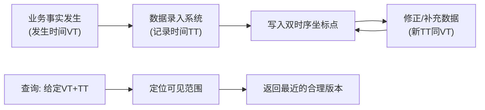

## 一句话总结
金融数据存在"业务发生时间"与"系统记录时间"两个维度,用双时序数据库管理这两个时间,可以保证任意时点的查询可重现、数据修订不污染历史计算,是公司级数据正确性的地基。

## 知识导图
- 计算输入正确性
  - 问题背景
    - 指标公布晚且会修订
    - 合同存续几十年
    - 跨部门统一数据访问
    - 查询必须可重现
  - 双时序数据库
    - 两个时间维度
      - 发生时间 VT
      - 记录时间 TT
    - 与单时序的区别
      - 单时序管新增
      - 双时序管修改
  - 可见范围
    - 既存在且有意义
    - 选最近的合理数据
    - 与查询互相定义
  - 优缺点
    - 优点: 不变性与唯一性
    - 缺点: 学习与执行成本
  - 实践建议
    - 不限制发生时间范围
    - 失效用新版本覆盖

## 核心概念
- **发生时间(VT/valid time)**: 数据所描述的业务事实对应的时间,如"2018年3月的通胀率"。解决"这条数据说的是什么时候的事"。
- **记录时间(TT/transaction time)**: 数据进入系统的时间。解决"这条数据什么时候开始可查"。通胀率发生时间是3月,记录时间可能是4月甚至更晚。
- **单时序数据库**: 常见的时序数据库只有一个时间轴,只能处理数据的增加;双时序数据库多一条记录时间轴,专门处理数据的修改与更正。
- **可见范围**: 一个数据"能被查到"的查询坐标集合——查询时间落在该范围内,才能看到这条数据。它不是数据的固有属性,而是由查询结果反推定义的。
- **最近的合理数据**: 查询时在"既已录入(记录时间不晚于查询)、且已生效(发生时间不晚于查询)"的数据中,取发生时间最晚的一条。这与金融口语中"现在的股价"的语义一致——金融数据离散,不存在真正的"现在"。
- **情景计算(Scenario Analysis)**: 监管提出的假设性事件(挤兑、地震等)下重算合同。双时序让它只动记录时间、不动发生时间,从而与真实数据天然隔离。

## 核心要点
1. 一个金融数据自带两个时间:业务发生时间与系统记录时间,二者组成二维坐标系。
2. 查询必须同时给出发生时间和记录时间,坐标落在谁的可见范围内,就返回谁。
3. 可见范围与查询互相定义:数据可见范围 = 能查询到该数据的所有查询时间点。
4. 修正旧数据(相同发生时间、新记录时间)会截断旧版本的可见范围,查询自动拿到最新版本。
5. 优点:数据不变(不可篡改)+唯一标识(两个时间即主键),查询可精确复现历史。
6. 用合同签订时刻做查询坐标,几十年前的合同用过的数据可完整还原,不受后续修订影响。
7. 固定发生时间、遍历记录时间,即可单独分析某次修订的影响,做到只改想改的。
8. 缺点:业务、产品都要理解二维时间,教育成本高;多一个索引,插入与查询都更慢。
9. 实践中不建议给发生时间设置有限的可见范围(如房贷30年):逻辑与查询优化都过于复杂;数据失效用写入一个"无效版本"来实现。
10. 双时序是大型机构金融的公司级框架,规模越大、历史越长价值越大;普惠金融一般用不上。

## 架构与流程

## 关键对比
| 维度 | 单时序数据库 | 双时序数据库 |
| --- | --- | --- |
| 时间维度 | 1个(发生时间) | 2个(发生+记录) |
| 解决的问题 | 数据增加 | 数据修改/更正 |
| 修改语义 | 覆盖旧值,历史丢失 | 新版本叠加,历史完整保留 |
| 性能与成本 | 快、简单 | 多一维索引,学习与执行成本高 |
| 典型场景 | 一般时序数据 | 机构金融的公司级正确性框架 |

## 易混与坑
- "现在的利率是多少"在逻辑上是"离现在最近的一条利率数据",因为金融数据是离散的。
- 可见范围是查询视角的产物,不能脱离查询孤立地说"这个数据的有效期"。
- 出现同发生时间的新版本时,旧数据可见范围并非无限向上延伸,而是在新版本生效处被截断——这是"最近合理数据"规则的必然结果。
- 理论上发生时间可以有有限区间(房贷30年),实践会带来覆盖关系和查询优化的复杂度,不推荐。

## 自测问题
- 为什么金融公司需要双时序而不是普通时序数据库?(因为要处理数据修订,且要求历史查询几十年可重现)
- 查询(2018-9, 2018-3)但该数据9月才被更正,返回什么?(返回4月录入的旧版本,更正版本的记录时间晚于查询的记录时间,不可见)
- 双时序数据库的两个核心优点是什么?(数据不变性、数据唯一性,由此保证查询结果可复现)
- 如何用双时序支持监管情景计算?(只调整记录时间引入假设数据,业务发生时间不变,真实数据不受影响)
- 为什么不建议限制发生时间的可见范围?(多个有限范围互相覆盖导致定义和查询优化过于复杂,用新版本覆盖更简单)
