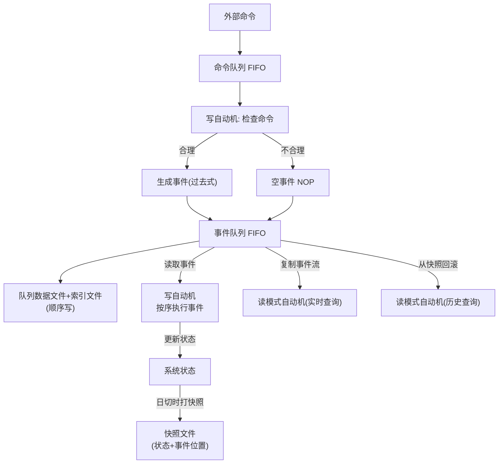

## 一句话总结
用事件溯源(Event Sourcing)架构:命令经检查生成事件、按 FIFO 顺序存储、由无随机性的自动机按序重放,使任意历史状态可复现、可审计、可容灾,这是金融行业沉淀多年的过程正确性方案。

## 知识导图
- 事件溯源
  - 三大术语
    - 命令: 待检查的指令
    - 事件: 检查通过必执行
    - 状态: 执行改变的对象
    - 一命令可生多事件
  - 队列处理
    - FIFO 保证全局顺序
    - 顺序一致可合并队列
  - 队列存储
    - 顺序写对硬盘友好
    - 内容文件+定长索引
  - 自动机执行
    - 禁真实随机数
    - 禁外部 IO
    - 外部输入预存入队
  - 时光机与快照
    - 重放回滚任意时点
    - 审计与容灾能力
    - 快照截断恢复时间
    - 日切定时打快照
  - 查询 CQRS
    - 读写分离
    - 读模式自动机
    - 历史查询靠回滚
  - 数学本质
    - 不可变架构
    - 状态为事件累积和
    - 函数不可交换
    - 线性序列对应FIFO

## 核心概念
- **命令(Command)**: 系统收到的外部指令,如转账请求。命令先做合理性检查,可能被拒绝,因此不保证执行。
- **事件(Event)**: 命令检查通过后的结果,是"一定执行、执行一定成功"的事实用过去式表示("moved right" vs "move right")。检查不通过可不生成事件,或生成不改变状态的空事件(NOP)以保留痕迹。
- **状态(State)**: 事件执行改变的对象与结果,如账户余额。
- **自动机**: 把事件队列当作无限磁带、从头逐条读取并改变状态的经典计算模型,是事件溯源的执行引擎。
- **时光机**: 重置自动机并重放事件,可精确恢复到任意历史时点的状态;既支撑审计("为什么"),也支撑容灾。
- **快照(Snapshot)**: 把当前状态连同对应事件位置存入文件;恢复时先加载快照再重放其后事件,使恢复时间只取决于快照之后的事件数。
- **CQRS**: 读写分离。写组件只管命令与事件,查询由独立的"读模式自动机"(只执行事件不处理命令)提供。
- **不可变架构**: 事件溯源所属的更大架构族,数据一律不可变,分为事件与状态两类。

## 核心要点
1. 金融不仅要求系统正确,还要求能解释系统为什么正确,事件溯源为此而设计。
2. 命令和事件的处理必须有确定顺序:同样两条命令,到达顺序不同,产生的事件可能不同(先收100再付200 vs 先付200再收100)。
3. 命令队列与事件队列顺序完全一致,可合并为一个队列:命令处理出事件后,命令与事件打包落盘。
4. 队列只在末尾追加(顺序写),能吃满硬盘顺序吞吐,这是事件溯源存储高效的原因。
5. 每个队列要存两个文件:内容文件+定长索引文件,靠"位置×定长"直接计算偏移定位第N条。
6. 自动机执行禁止随机性:禁硬件真随机数;伪随机数可把算法与种子记入事件后使用;禁止执行期外部 IO,外部输入要提前存进事件队列。
7. 快照频率是"恢复时间 vs 运行开销"的权衡;金融系统靠日切(每晚12点清点)自然形成快照节奏,月/季/年结可复用。
8. 实时查询:复制事件流到读模式自动机重放(类似游戏直播用电脑复现手机状态);历史查询:从最近快照回滚到目标时点;可部署多个读模式自动机分别锚定不同时点。
9. 数学本质:状态 Sₙ = S₀ + e₁ + … + eₙ(事件效果的累积和/积分,事件即状态对时间的导数);自动机函数无随机性、且一般不可交换(参数换序结果不同),故数据构成线性序列,天然对应 FIFO 存储。正因与数学严格对应,才能像验证公式一样验证系统正确性。

## 架构与流程

## 关键对比
| 维度 | 互联网架构 | 金融架构(事件溯源) |
| --- | --- | --- |
| 关注点 | 当前事实("是什么") | 变化原因("为什么") |
| 记录倾向 | 记录状态 | 记录原因(命令/事件) |
| 历史回溯 | 一般不需要 | 必须可审计、可复现 |
| 容灾方式 | 多副本 | 事件重放+快照 |

## 易混与坑
- 命令≠事件:不合理的命令不会变成事件,事件一旦生成则执行必然成功——这一步检查是正确性的关键闸门。
- 禁的是"真随机":伪随机数只要把算法与种子写入事件,重放结果依然确定。
- 事件不会触发事件,触发的是命令;命令再生成新事件,命令可以带随机性,事件执行不能。
- 快照里必须记录对应的事件位置,否则自动机不知道从哪条事件继续执行。
- 历史查询与实时查询可结合:多个读模式自动机分别停在最新状态与日切时点。

## 自测问题
- 为什么事件用过去式命名?(表示命令已通过检查、是必然执行的事实,与可能被拒绝的命令区分)
- 事件溯源为什么必须 FIFO?(自动机函数不可交换,事件顺序不同结果不同,故数据是线性序列)
- 快照解决了什么问题?(把容灾恢复时间从事件总长度降为快照之后的事件数,与历史长度无关)
- 自动机执行时哪两类行为被禁止?(真实随机数与执行期外部 IO;外部输入需提前写入事件队列)
- 如何查询任意历史时点的状态?(从最近的快照加载状态,再重放到目标时点,即回滚/时光机)
