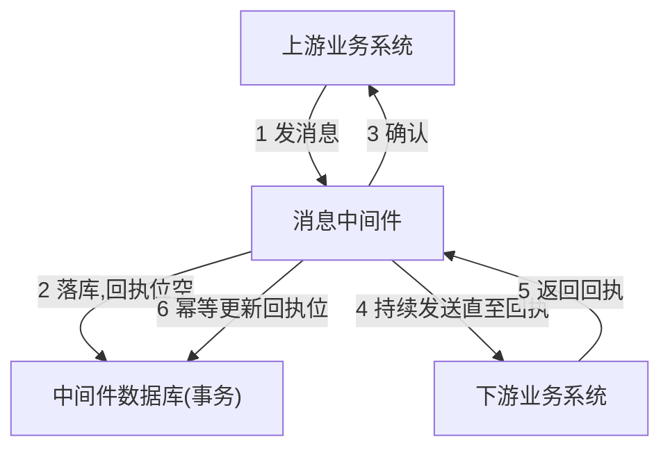

## 一句话总结
单个组件正确不代表系统正确,要把组件间不确定的交互变确定:事前保证输入内容与顺序、事中靠函数式编程与精度控制、事后用独立环境验证,消息传输用"事务+幂等"兜底。

## 知识导图
- 结果正确性
  - 事前: 内容
    - 双时序查对时间
    - HMAC 完整性校验
    - 版本号做兼容
  - 事前: 顺序
    - 不乱序
      - 自增 ID+缓冲区
      - 线性一致性
    - 至少一次
      - 重发直到回执
      - 事务存回执位
    - 至多一次
      - 唯一 ID 去重
  - 事中
    - 函数式编程可组合
    - 计算精度边界
  - 事后
    - 换环境独立验证
    - 验证一次或三次
    - 实时/异步验证
    - 日切对账补偿

## 核心概念
- **内容正确性**: 上游对数据内容负责——用双时序查对时间,加 HMAC 防传输/读取损坏,加版本号标识数据格式以支持升级后的向下兼容。
- **线性一致性**: 不乱序的理论要求(第13讲展开)。实现上与 TCP 同思路:消息带自增 ID,接收端把提前到达的消息放入缓冲区,等目标 ID 出现再按序取出。多 TCP 链路/多路由下单靠 TCP 不够,需应用层重做。
- **至少一次(At-least-once)**: 非确定性网络下回执本身也可能丢,发送方只能持续重发直到收到至少一次回执。由"事务记录回执状态+幂等更新回执位"两个保证支撑。
- **幂等性**: 同一操作执行多次与一次结果相同(如把回执位反复置为成功)。去重就是让消息处理幂等化。
- **去重与唯一ID**: 至少一次必然带来重复,靠唯一 ID 只处理第一条。ID 来源:自增 ID(需消息系统可控格式)、业务属性(支付订单号)、与业务无关的数据库主键或摘要(MD5/SHA1)。
- **函数式编程**: 数据不可变、函数无随机,函数可像积木一样组合而不破坏正确性(Composibility),程序不因代码增长而失去正确性。金融大规模使用:Slang/SecDB(高盛)、A+/Scala(大摩)、OCaml(Jane Street)、Haskell(渣打)。
- **异步验证与日切对账**: 事后验证不阻塞对外输出,错了靠业务补偿(补账),日切/对账即异步验证的落地形态。

## 核心要点
1. 计算三段论:收到请求(事前)、处理请求(事中)、输出结果(事后),每段都有独立的正确性手段。
2. 找到正确时间的数据还不够,还要校验完整性(HMAC)并带上版本号。
3. 不乱序是对接收端的要求,发送端因异步网络和多链路无法保证有序。
4. 上游至少一次:消息中间件有自己的数据库,消息带回执标识位,无回执则无限重发、重启后重发所有未回执消息。
5. 为什么用事务数据库:回执状态是"下游客观状态",必须在上游任意故障下仍被正确记录。
6. 下游经典错误是先回执再处理:重启即丢消息且上游不再重发;正确做法是先落库(未执行态)、再回执、处理完再标记。
7. 上下游中间件可合并为一个消息系统(企业总线),6步交互比两套中间件省4步。
8. 事中正确性是软件工程问题:函数式编程学习成本高,但正确性维护成本低,符合金融投资回报比。
9. 精度问题只在金额极大时出现(175千万亿津巴布韦元、500万亿日元GDP),对接机构越大越要提前设防。
10. 事后验证必须降低与原计算的相关性:换语言、换人、换架构、换云厂商;曾有案例是宇宙射线损坏 CPU 浮点寄存器导致算错。
11. 验证次数:航天级4套系统取至少3个一致结果;金融验证1次基本够。实时验证防患未然但加延时,异步验证需要补偿能力。

## 架构与流程

## 关键对比
| 维度 | 至少一次 | 至多一次 |
| --- | --- | --- |
| 保证目标 | 消息不丢 | 消息不重 |
| 关键机制 | 重发+事务化回执位 | 唯一 ID 去重 |
| 依赖关系 | 基础保障 | 建立在至少一次之上 |
| 风险 | 下游可能收到重复消息 | 去重库容量有限,归档后可能漏判 |

| 维度 | 实时验证 | 异步验证 |
| --- | --- | --- |
| 时机 | 公布结果前 | 公布结果后 |
| 优点 | 防患于未然 | 不增加系统延时 |
| 代价 | 增加延时 | 需业务补偿能力(日切对账) |

## 易混与坑
- "不乱序"不要求发送端按序:异步网络下发送端做不到,只约束接收端。
- 回执悖论:回执也是消息、也会丢,所以"至少一次"只能靠无限重发逼近。
- 先回执后处理是下游最常见的事故来源,顺序必须反过来。
- 错误结果未必是人为 bug,硬件与环境也会出错,验证要换计算环境而不是复跑同一环境。
- 去重库归档删数据后,老 ID 重放可能被当新消息处理(思考题:给 ID 引入逻辑时间解决)。

## 自测问题
- 为什么保证至少一次必须用支持事务的数据库?(回执位记录的是下游客观状态,要在上游任何故障下保持正确)
- 下游系统接收消息的正确顺序是什么?(先落库标记未执行→回执→交业务处理→标记已执行)
- 至多一次如何实现?(给消息唯一 ID 并去重,只处理第一条,ID 可来自自增序号/业务单号/库主键或摘要)
- 为什么金融业青睐函数式编程?(数据不可变+函数无随机→可自由组合且正确性不退化,长期维护成本低)
- 事后验证为什么强调"换环境"?(降低与原计算的相关性,排除同源软硬件错误,如 CPU 寄存器故障)
