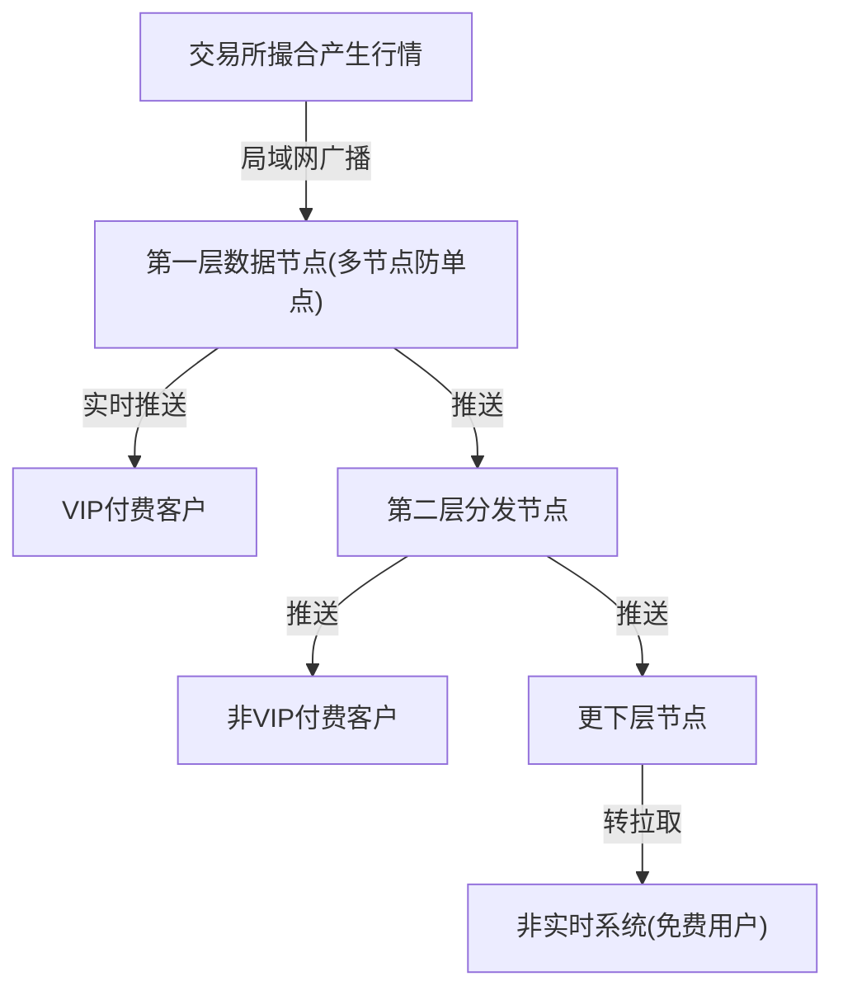

## 一句话总结
金融数据分交易数据与市场数据两类:交易数据要保持事务性(顺序+一次)并做好限流;市场数据非事务性,按时效性分级——非实时用订阅发布可容忍丢数据,实时靠付费层级分发与二进制协议压缩。

## 知识导图
- 数据传输质量
  - 场景模型
    - 券商对接交易所
    - 订单+行情两类流
  - 交易数据
    - 事务性: 顺序+一次
    - 限流
      - 漏桶: 匀速放行
      - 令牌桶: 平均+峰值
      - 组织间假设恶意
  - 市场数据
    - 非事务性可丢
    - 非实时
      - 订阅发布: 全量独立
      - 消息: 共享断续
      - 时效性允许缺失
      - 降 ISR 换速度
    - 实时
      - 席位费分级
      - 同机房换低延时
      - 广播+层层分发
      - FIX 只传差量

## 核心概念
- **交易数据**: 订单等事务型数据,传输要满足上一讲的顺序正确性与恰好一次(不乱序+去重)。
- **市场数据**: 全市场成交信息(行情)。算法平台关心的是所有人的行情而非自己的成交,故不需要事务保证,允许丢数据——这是选型自由的来源。
- **漏桶算法**: 请求进固定容量桶,匀速消费,桶满丢弃。适合强制平滑对外发送速度(券商对交易所)。
- **令牌桶算法**: 系统匀速放令牌,消费消息需耗令牌;放令牌速度决定平均速率,桶容量决定峰值处理能力。适合总流量限流时做微调(交易所)。
- **订阅发布(Pub/Sub)**: 每个消费者独立收到全部消息,各自按相同顺序处理(如 Kafka、Google Cloud Pub/Sub 的原始设计)。
- **消息(Messaging)**: 所有消费者共享消息,各自只处理一部分,单视角看消息是断续的(ActiveMQ、SQS、RabbitMQ、RocketMQ 的原始设计)。
- **时效性**: 不同时间的数据价值不同。市场数据越新越值钱、旧数据价值衰减快,因此允许丢失——丢失后等一会儿其重要性自然下降。
- **ISR(同步数)**: Kafka 同步副本数,设为0即放弃同步等待,牺牲容灾换处理速度。
- **席位费**: 交易所对低延时实时数据的收费分级;同机房托管可把光速延时压到忽略不计,但位置稀缺、天价。
- **FIX 协议**: 金融专用二进制通讯协议;利用行情连续两条大部分相同的特性只传变化部分,思想同视频压缩关键帧。

## 核心要点
1. 组织间系统对接要假设发送方恶意,接收方必须限流——这是与互联网内部限流的本质差异。
2. 券商用漏桶限制自己发出的速度;交易所对总流量可用令牌桶获得"平均可控+峰值可冲"的弹性。
3. 一旦上下游限流,就要假设数据会丢:需处理订单发不出去、发出后不被执行两种情况。
4. 判断市场数据是否事务型的关键:你关心的是"自己订单的成交"(事务)还是"所有人的行情"(非事务)。
5. 算法交易平台需要全部历史信号→选订阅发布;这也是 Kafka 在金融系统越来越普及的原因。
6. 非实时市场数据处理与互联网接近;利用时效性可降 Kafka 同步数换速度,但要配监控防数据频繁丢失。
7. 实时市场数据的消费者不平等:谁付钱多谁的延时低,所以分发架构天然是层级结构。
8. 交易所顶层用局域网广播(所有一层节点同时收到)替代 Kafka 式主备同步,因为主备通讯的网络延时不可接受。
9. 低延时架构优化的是延时而非吞吐量:VIP 用户少,实时推送的硬件开销可控;从经济学看 VIP 越少席位费越贵,总盈利反而可能更高,系统无需支持大量 VIP。
10. 实时系统大部分时间耗在编解码:禁用 JSON/XML(给人看的冗余),要求不高用 Protobuf,金融场景用 FIX;FIX 只传变动字段。
11. 数据分层分发到某层后对接非实时系统,推送变拉取,免费用户从此访问。

## 架构与流程

## 关键对比
| 维度 | 漏桶算法 | 令牌桶算法 |
| --- | --- | --- |
| 桶里装什么 | 待消费消息 | 令牌 |
| 处理节奏 | 严格匀速 | 平均速度+峰值爆发 |
| 适用位置 | 券商限制自身对外发送 | 交易所总流量微调 |

| 维度 | 订阅发布 | 消息 |
| --- | --- | --- |
| 消费关系 | 各消费者独立全量 | 共享消费各取部分 |
| 单消费者视角 | 完整连续 | 断断续续 |
| 典型系统 | Kafka、Pub/Sub | RabbitMQ、SQS、RocketMQ |
| 券商行情需求 | 符合(要全量历史) | 不符合 |

## 易混与坑
- 金融不是处处高要求:非实时市场数据与互联网架构几乎一样,别过度设计。
- 互联网消息系统默认客户端定时拉取(Kafka 客户端即如此),实时系统必须推——优化目标从吞吐量换成了延时。
- 实时数据不可缓存补发:缓存后再给,提供的就不再是实时数据(答疑集锦观点)。
- 数据优化第一杠杆是"量小":先把数据压小,再谈传输快。
- 市场数据允许丢,但不等于可以频繁丢,监控告警必须配齐。

## 自测问题
- 券商与交易所各自该选什么限流算法?(券商漏桶限制自己发送;交易所总流量可用令牌桶,兼顾平均与峰值)
- 为什么券商算法平台选订阅发布而不是消息?(算法平台需要全部历史行情信号,不能接受只消费一部分)
- 市场数据为什么允许丢失?(时效性:旧数据价值迅速衰减,丢失影响小,可换传输速度)
- 交易所顶层为什么用广播而不用 Kafka 主备同步?(主备同步引入网络延时,广播让一层节点同时收到数据)
- FIX 协议为什么快?(二进制编码体积小,且利用连续行情相似性只传变化部分,类似视频压缩)
