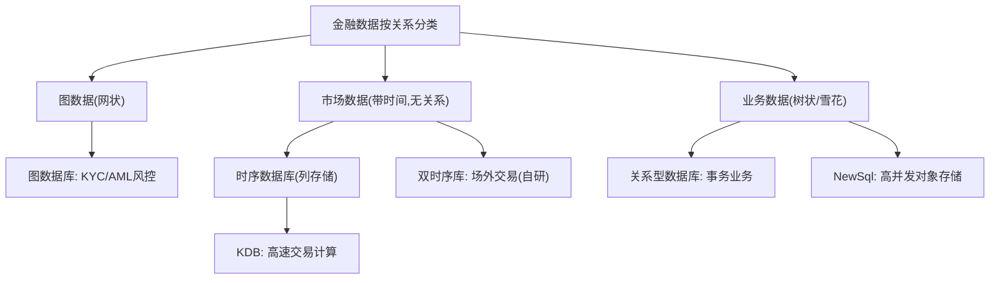

## 一句话总结
按数据关系的复杂度选存储:图数据配图数据库(仅风控/KYC),无关系的市场数据配列存储时序数据库(KDB),树状业务数据配关系型数据库;NewSql 解决对象存储但查询一致性仍是金融观望的原因。

## 知识导图
- 存储选型
  - 按关系分类
    - 图: 网状非结构化
    - 无关系: 带时间序列
    - 树状: 雪花业务结构
  - 图数据库
    - 金融业务少用
    - KYC/AML 分析场景
  - 时序数据库
    - 行存 vs 列存
      - 行存整行加载慢
      - 列存按列读快
    - 市场数据是业务结果
    - KDB
      - 函数式 Q 语言
      - 向量指令加速
      - 单线程免锁
      - GB~TB/贵/难学
    - 双时序≠时序
      - 不能列存/无向量
      - 场外交易自研
  - 关系型数据库
    - 对象关系阻抗不匹配
    - 图论 vs 集合论
    - NewSql 原子存对象
    - 二级索引最终一致
    - 万金油靠事务

## 核心概念
- **数据分类三象限**: 按数据间关系复杂度——无关系(市场数据)、树状(业务数据)、网状(图数据),分别对应时序、关系型、图数据库。选型先分类,再匹配。
- **行存储 vs 列存储**: 存储设备是一维的,二维数据矩阵必须降维。行存横向切割,每行整体存取,查某几列也要加载整行;列存纵向切割,只加载需要的列,大量 IO 被省掉。市场数据求"某段时间某几列"的聚合,天然适合列存。
- **KDB**: 金融行业最强的列存储数据库,自带函数式语言 Q(源自大摩的 A+、数学语言 A,与 Lisp 同族)。Q 中数据不可变、函数无随机,函数可视为参数到返回值的 Map;表与 Map 通过 flip 互转(列名即键)。实时编译 Q 以使用 CPU 向量指令,一条指令处理多个同类型数据。
- **双时序数据库 vs 时序数据库**: 名字相近实现迥异。双时序多一维时间,无法按列存储、无法用向量指令加速,吞吐上不去,不适合股票外汇等高频业务,适合债券、期货、资产证券化等场外业务;无通用产品,是大型金融公司自研的核心竞争力(实现难点在时间索引,可用空间树)。
- **对象关系阻抗不匹配**: 面向对象的关系是图(图论),关系库的模式是同构列表的集合(集合论),把对象存入关系库等于把图论翻译成集合论,天然别扭;且对象有封装与行为,库里只有原始数据,抽象层次不同。
- **NewSql(旧称 NoSql)**: 解决两个问题——高并发高流量、树状数据存储。对象可作为原子单元(如 JSON)存储,缓解阻抗不匹配;但分布式架构下二级索引只能最终一致,查询可能不准。

## 核心要点
1. 金融业务要求结构清晰,本质不是非结构化数据,所以图结构在金融业务中很少。
2. 图数据库主要在数据分析部门用:KYC 背景调查、AML 反洗钱,分析客户社会关系与资金网络。
3. 市场数据是业务处理的结果(撮合、交易之后产生),不是业务问题,不适合为"整行业务读写"优化的行存储。
4. 列存储的优势贯穿存、读、算:只读需要的列,CPU 向量指令再加速同列计算。
5. KDB 适用数据量 GB~TB,重内存;学习门槛高(Q 如 Lisp)且昂贵,但开发与运行速度带来的投资回报比让顶级金融公司买单。
6. 互联网列数据库(如 ClickHouse)与 KDB 技术大同小异,行业技术正在出圈融合。
7. 关系型数据库是金融万金油,核心原因是事务支持极大简化了架构难度。
8. 只有业务量大到必须分布式时,才值得为 NewSql 承担异步架构与最终一致性的复杂度——这是金融业对其观望的原因。

## 架构与流程

## 关键对比
| 维度 | 行存储(关系型) | 列存储(时序/KDB) |
| --- | --- | --- |
| 降维方式 | 横向切割,按行 | 纵向切割,按列 |
| 查询代价 | 整行加载到内存 | 只加载所需列 |
| 优化目标 | 单行业务完整读写 | 聚合分析、批量计算 |
| 适合数据 | 业务数据 | 市场数据 |
| 加速手段 | 索引 | CPU 向量指令、实时编译 |

| 维度 | 关系型数据库 | NewSql |
| --- | --- | --- |
| 对象存储 | 阻抗不匹配,需技巧 | 对象作原子单元 |
| 一致性 | 强事务 | 二级索引最终一致 |
| 架构复杂度 | 低(事务兜底) | 高(异步/分布式) |
| 金融态度 | 万金油默认选项 | 观望,量大才升级 |

## 易混与坑
- 双时序数据库名字里带"时序",实现与适用场景和时序数据库完全不同,不能混为一谈。
- 单线程不一定慢:省掉线程切换与同步锁开销后,KDB 反而极快;KDB 的单线程是有列存+向量指令托底的。
- "别人都在用关系型库"是借口不是理由;关系库真正的理由是事务大幅降低架构难度。
- 对象与数据抽象层次不同:对象=数据+行为+封装,库里只有原始格式,公有私有、继承、校验都无法直接表达。
- Codd 50年前的奠基论文就提出"表的值可以是表",JSON 列并非颠覆性新概念。

## 自测问题
- 为什么计算3个时间点的买入均价时列存储快得多?(只需加载买价一列,行存要把整行全部加载)
- 市场数据为什么不适合关系型数据库?(它是业务处理的结果而非业务问题,关系库优化的是整行业务数据的读写)
- KDB 的速度来自哪三个设计?(列存储 IO、CPU 向量指令+实时编译、单线程免锁)
- 对象关系阻抗不匹配的数学根源是什么?(对象关系是图论,关系库模式是集合论,两套理论翻译不自然)
- 金融业对 NewSql 观望的直接原因是什么?(分布式下二级索引只能最终一致,查询可能不准)
