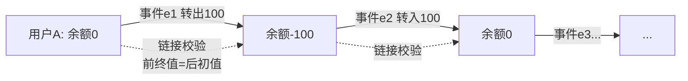

## 一句话总结
本篇是模块二的思考题总解:给出双时序矩形复杂度、事件文件完整性检测、去重 ID 逻辑时间、实时速度协调、JSON 列取舍、热点账户拆分六题的参考答案,并加餐账务系统的合并存储与链式对账优化。

## 知识导图
- 答疑集锦二
  - 06 双时序矩形
    - 空间 O(n平方)
    - 查询 O(log n)
    - 高成本限低吞吐
  - 07 文件完整性
    - 索引存事件校验码
    - 索引尾部逐条验证
    - 先事件后索引
  - 08 去重 ID
    - 归档致漏判
    - 引入逻辑时间
    - 业务保证有序
  - 09 实时提速协调
    - 不可缓存补发
    - 丢弃+反馈降速
    - 按性能上限选席位
  - 10 JSON 列
    - 顶层以下无模式
    - 速度vs可维护性
    - 严格场景加强测试
  - 11 热点账户
    - 独立分库
    - 拆子账户/科目
    - 纵向扩容
  - 加餐账务优化
    - 事件带前后状态
    - 查询免回放免快照
    - 链式对账似区块链

## 核心概念
- **矩形切割存储(06题)**: 双时序坐标空间按新增数据点做水平垂直切割成矩形,索引建在矩形左下/右上角坐标上。空间复杂度 O(n²),查询 O(log n) 或 O(1)——高存储成本正是双时序只适合低吞吐场外业务的原因(呼应第10讲)。
- **完整性检测(07题)**: 索引文件每条末尾存"此前所有内容的校验码";事件文件的校验码(MD5/SHA1/HMAC)放在对应索引里,两文件联合检测。线性写文件损坏只在末尾:索引文件先裁剪到单条索引大小的整数倍,再从末尾逐条校验、不完整即丢弃。
- **逻辑时间(08题)**: 让去重 ID 之间满足线性关系(任意可比、可传递,且后生成者更大),ID 反映事件顺序。ID 带时间/自增成分后,归档删除形成连续区间,只需判断新 ID 是否落在已删区间即知是否可能重复;由业务系统保证逻辑时间正确。
- **实时数据速度协调(09题)**: 实时数据过期即失效,不能进队列缓存补发(补发的已不是实时服务)。接收方处理不过来就丢弃,并返回丢弃通知让发送方降速,稳定后回升——思想同 TCP 带宽探测。
- **合并存储(加餐)**: 账务状态是简单 K/V,可在生成事件的同时"假装执行"得到前后余额,把事件与前状态、后状态一起存储。
- **对账链(加餐)**: 两条不变式——前一事件的最终余额=后一事件的初始余额;事件最终余额=初始余额+变动金额。把相邻余额、事件前后余额链接成链,任一状态可沿链校验全部变动过程。

## 核心要点
1. 双时序矩形方案的空间开销随数据点数平方增长,决定了它服务不了高频场景——复杂度分析与业务选型闭环。
2. 事件溯源不要一发现文件不完整就整个丢弃:恢复成本太高,应逐条抢救可用部分。
3. 两文件写入顺序:先事件文件、后索引文件,否则索引可能指向未落盘的事件。
4. 去重问题的本质是"检测元素是否属于大集合",与其无限扩容去重库,不如让 ID 有序化,把问题降为区间判断。
5. 实时传输的丢数据不是故障而是设计:过期数据没有找回价值,双向速度协调防止无谓浪费网络处理时间。
6. JSON 列的推广是权衡题:无 schema 提快上线速度,但顶层以下零约束推高长期维护成本;正确性严格的场景要么不用,要么按超出常规关系库的力度测试。
7. 超大流量账户三板斧:单独分库(性价比常最优)→账户拆分/科目记账(只追加、顺序写、无余额累加)→纵向扩容(升级单机)。
8. 合并存储后,历史查询退化为"找最近事件读其附带状态",常规时序库即可支持,且连快照都不再需要。
9. 链式对账把内部对账从"另建系统重算总额"变为"沿链逐点校验",与区块链本质相同,差别仅在后者用非中心化共识建链。
10. 加餐点题:完整软件系统不是一蹴而就,是在通用方案上按业务特性逐步迭代(事件溯源→账务特化)。

## 架构与流程

## 关键对比
| 维度 | 通用事件溯源 | 账务系统特殊优化 |
| --- | --- | --- |
| 历史查询 | 快照+回滚重放 | 找最近事件直接读附带状态 |
| 快照 | 需要(日切) | 可完全省去 |
| 对账方式 | 另建系统重算总额比对 | 沿余额链逐点校验 |
| 存储内容 | 仅事件 | 事件+前后状态(冗余换查询) |

## 易混与坑
- 文件完整性检测可以跨文件协同:用索引文件校验事件文件,不必给每个事件单独存校验块。
- 索引自身完整性靠"每条末尾放此前内容的校验码"+从尾部逐条回退验证。
- 缓存实时数据再补发=提供过期的服务,不如不缓存;正确做法是丢弃并反馈降速。
- 去重 ID 归档后漏判的解法不是保留更多数据,而是给 ID 加逻辑时间、把问题变成区间判断。
- 区块链思想在账务里的对应物就是"前后余额链接",不要把它神化成另一种技术。

## 自测问题
- 矩形切割方案的空间与查询复杂度各是多少?对业务选型有何暗示?(O(n²) 与 O(log n)~O(1);高成本决定只适合低吞吐场外业务)
- 事件文件和索引文件应按什么顺序写?为什么?(先事件后索引,避免索引指向不存在的事件)
- 什么是逻辑时间?它解决什么问题?(ID 满足线性关系且反映产生顺序;解决去重数据归档后的重复判别)
- 实时数据系统收到过快推送该怎么办?(丢弃过期数据并通知发送方降速,做双向速度协调,而非缓存)
- 账务系统把事件与前后状态合并存储带来哪两个收益?(历史查询找最近事件即可、不再需要快照;对账可沿链逐点校验)
