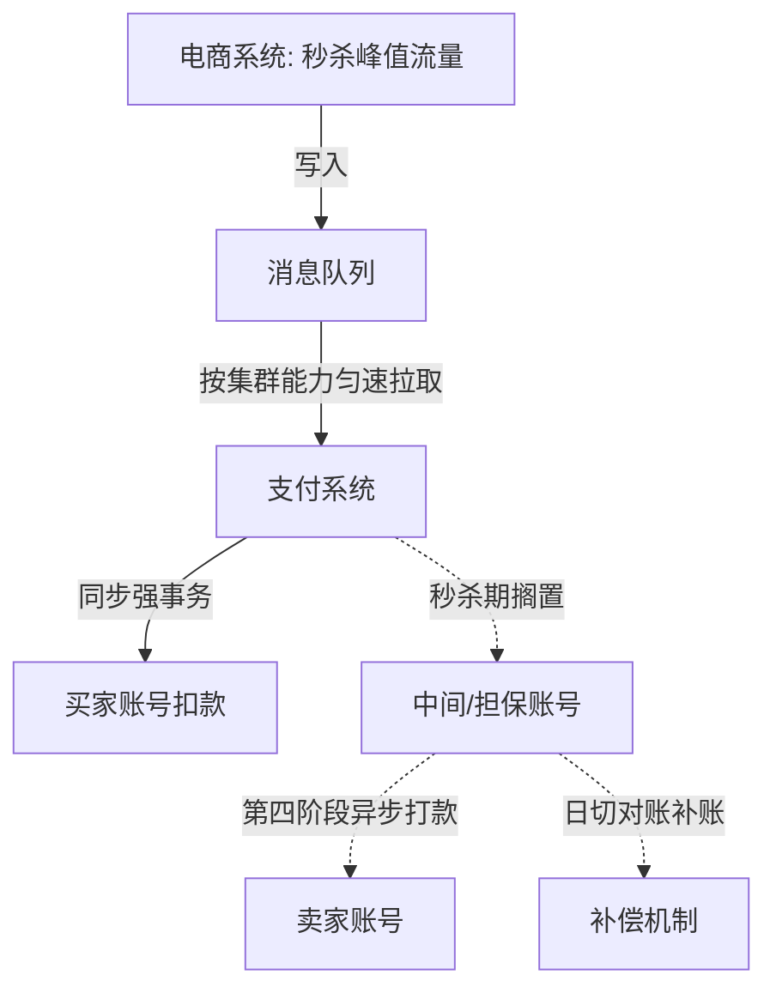

## 一句话总结
互联网的"快"是吞吐量(边际成本趋零、拼规模),金融的"快"是延时(边际成本高、拼质量);吞吐量靠分库分表与消息队列削峰填谷,延时靠单机微观优化(单线程/绑核/内存池)与 epoll、io_uring 网络优化。

## 知识导图
- 系统优化
  - 快的两义
    - 互联网: 吞吐量大
    - 金融: 延时低
    - 普惠金融近互联网
  - 吞吐量优化
    - 分库分表
      - MECE 切分原则
      - 哈希切分: 打散流量
      - 范围切分: 连续友好
      - 四大问题
        - 分布式事务
        - 最低延时
        - 必须容灾
        - 库数难调
    - 消息队列
      - 削峰填谷
      - 秒杀三阶段
      - 担保账号异步化
  - 延时优化
    - 单机
      - 单线程免调度
      - 绑核+isolcpus
      - 内存顺序访问
      - 内存池
      - 顺序写/mmap
    - 网络
      - epoll: 事件通知
      - io_uring: 内核批量

## 核心概念
- **边际成本与"快"的定义**: 互联网业务边际成本≈0,倾向大规模扩张→海量用户→大流量→"快"指集群吞吐;机构金融要做 KYC、业务/财务/合规流程,无法规模扩张,只能拼质量→时间就是金钱→"快"指延时低。普惠金融(支付、小额信贷)归互联网一边。
- **分库分表**: 将表横向/纵向切割后分散到多机,用更多硬件扛流量。切分要 MECE:子表互不重复(独立)且不丢数据(穷尽)。水平切分两法:按主键哈希(打散流量,但连续访问差)与按主键范围(区间连续对市场数据友好,但热点集中)。
- **消息队列削峰填谷**: 流量先写入队列,服务器按自身能力匀速拉取,峰值流量不再压垮系统。队列写入上限很高,通常不构成瓶颈。
- **担保账号异步化**: 秒杀付款先入担保账号而非直连卖家;中间账号扣款可延迟、甚至丢了靠日切对账补账,因此可异步处理,秒杀期只做买家账号一半的写操作。
- **单线程优化**: 多线程赢在资源多,但线程调度要更新内核结构与 CPU 缓存,"准备资源本身消耗资源";单线程+绑核(sched_setaffinity)+isolcpus 独占 CPU 可反超。
- **epoll**: Linux 独有,同时监听海量连接,就绪才通知,解决 C10K;但读写仍要用户态自己调内核函数,状态切换开销大。
- **io_uring**(2018): 把读写操作与预分配内存编成队列整体交给内核,内核在内核态批量完成 epoll+读写,经共享页表回传状态;省切换也省拷贝,生态尚不成熟。

## 核心要点
1. 优化前先判断业务属于哪一类:普惠金融走吞吐量路线,机构金融走延时路线。
2. 市场数据要按时间连续访问,哈希切分不适合,应按时间范围切分;但量化分析集中访问最近数据会造成热点。
3. 分库分表的代价:分布式事务(正确性)、至少两次网络通讯(最低延时)、机器越多故障概率越高(容灾)、库数一旦定死难调(容量),须提前"超前"规划库数。
4. 秒杀支付三阶段:平稳期→峰值(写入队列)→回落;处理速度上限=分库分表后集群总能力,峰值高但短、处理慢但长。
5. 结合业务规律再深挖:从付钱到商家收钱有天然时间差→中间环节异步化,秒杀期少一半账号操作。
6. 延时优化是纵向(微观资源)调配,与吞吐量的横向调配方法论不同。
7. CPU 层:绑核只保证自己不迁移,别人仍可来抢;isolcpus 独占才算真隔离。
8. 内存层:CPU 经缓存访问内存,按算法访问顺序组织多维数组可享顺序加载红利;C 语言 malloc 耗时且时长随机,延时敏感场景自建内存池。
9. 文件层:能顺序写就顺序写(事件溯源即是);必须随机写时用 mmap 把文件映射进页表,省去用户态与内核间数据拷贝。
10. 机构金融不适合云计算:云计算是宏观横向扩张的标准解,机构金融需要的是对进程、内核、硬件的微观控制。

## 架构与流程

## 关键对比
| 维度 | 互联网业务 | 机构金融业务 |
| --- | --- | --- |
| 边际成本 | 趋近于零 | 高(KYC/合规流程) |
| 竞争方式 | 规模扩张 | 质量与速度 |
| "快"的含义 | 集群吞吐量大 | 延时低 |
| 优化方向 | 横向: 分库分表+队列 | 纵向: 单机/内核/硬件 |

| 维度 | 哈希切分 | 范围切分 |
| --- | --- | --- |
| 分布特点 | 随机打散,流量均匀 | 区间连续,可能热点 |
| 连续访问 | 差 | 好(适合市场数据) |
| 典型风险 | 主键连续查询低效 | 最近数据单机过载 |

## 易混与坑
- 多线程"资源更多所以更快"有个隐含假设:计算间不互相抢占资源;线程调度与缓存刷新本身就是开销。
- sched_setaffinity 绑核后,其他程序仍可能抢占该 CPU;要 isolcpus 把核从系统里摘出来才算独占。
- 分库分表方案自带最低延时(分布式事务至少两次网络通讯),高频交易机构不可接受。
- 消息队列不是万能:削峰填谷用延时换吞吐,只适合对峰值时延不敏感的业务。
- 中间账号的打款在支付系统视角可以异步甚至丢失(日切补账兜底)——识别哪些环节不需要强事务,才是优化的关键。

## 自测问题
- 为什么金融和互联网对"快"的定义不同?(边际成本决定扩张方式:互联网拼规模要吞吐,机构金融拼质量要延时)
- 分库分表切分要遵守什么原则?(MECE:子表互不重复且切分不丢数据)
- 市场数据应该按哈希还是范围切分?为什么?(按时间范围:需要时间段连续访问,哈希会打散连续性)
- 单线程为什么可能比多线程快?(省掉线程调度、内核数据结构与 CPU 缓存的更新开销)
- io_uring 相比 epoll 的改进是什么?(把就绪检测与读写批量放内核态,共享页表,省状态切换和数据拷贝)
