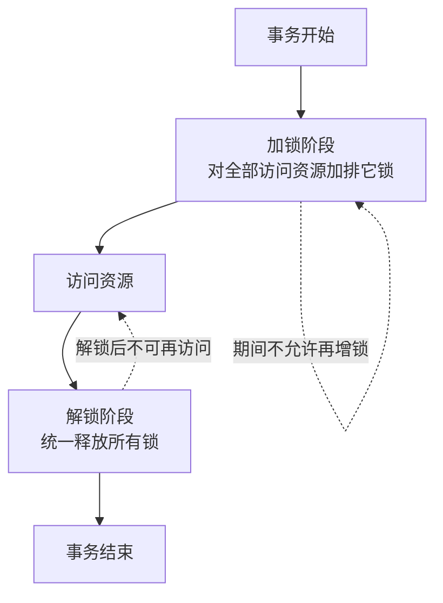

## 一句话总结
本讲在单机环境下定义了事务间"冲突"的三种类型，并据此建立隔离级别分级体系：从解决脏写的 Read Uncommitted 一路递进到解决全部冲突的可串行化，最后给出工程上最常用的快照隔离及其 MVCC 实现。核心主张：数据库宣称"支持事务"并不等于最高正确性，事务本身分很多等级。

## 知识导图
- 单机事务隔离级别
  - 冲突定义
    - 作用于同一对象
    - 至少一方是写
    - 后操作依赖前操作
    - 三种冲突
      - 读写冲突
      - 写读冲突
      - 写写冲突
  - 隔离级别阶梯
    - Read Uncommitted
      - 解决脏写(写写)
    - Read Committed
      - 加解决脏读(写读)
    - Repeatable Read
      - 加解决模糊读(读写)
    - 可串行化
      - 解决全部冲突
  - 可串行化
    - 等价于某顺序执行
    - 对任意初值结果相同
    - 某个顺序不唯一
    - 分而治之降低成本
  - 冲突可串行化
    - 无冲突互换调整次序
    - 是可串行化的子集
    - 2PL 实现
      - 先全加锁再访问
      - 最后统一解锁
      - 需预知访问数据
  - 快照隔离与 MVCC
    - 事务开始打快照
    - 读写互不干扰
    - 快照只含已完成事务
    - MVCC 实现
      - 数据只增不改
      - 修改即新增版本
      - 删除打标签待回收
      - 隐藏列记录事务
    - 属只读架构思想
  - SSI(思考题)
    - 乐观并发控制
    - 提交时查冲突

## 核心概念
- **冲突**：两个操作作用于同一对象且至少有一个是写操作。排除双读情形后，冲突只有读写、写读、写写三种；写读冲突要求写事务回滚才暴露问题，读写冲突则要求写事务提交。
- **隔离级别（Isolation Level）**：对"不正确"程度的分级。经典出处是 1995 年论文《A Critique of ANSI SQL Isolation Levels》，每一级比低一级多解决一种冲突。
- **可串行化（Serializability）**：并发事务的最终结果永远等价于它们按某个顺序一个接一个执行的结果。"永远"指对任意初始值都成立；"某个"意味着等价顺序不必唯一，所以可串行化自带一定随机性。
- **冲突可串行化（Conflict Serializability）**：更强(更苛刻)的等价定义——要求能通过一系列"无冲突互换"把原执行序列调整为串行执行。它是可串行化的充分条件，其集合是可串行化的真子集；有些可串行化的调度无法通过无冲突互换达成。
- **2PL（Two Phase Lock）**：两阶段锁。事务先对所有要访问的资源加排它锁，访问完再统一释放，加锁与解锁不交替。注意与 2PC（两阶段提交）完全是两回事。它能实现冲突可串行化，但要求事务提前知道要访问哪些数据，释放任一锁后不能再加新锁。
- **快照隔离（Snapshot Isolation）**：事务开始时为所有"正确"数据打一个不可变快照，此后读写互不干扰、无锁等待。正确=只包含已完成事务的数据，排除进行中和尚未开始的事务。
- **MVCC（Multi-Version Concurrency Control）**：快照隔离的典型实现。数据只增不改，修改分解为"删旧标新增"，删除只是打标签由垃圾回收器择机回收；每行有隐藏列记录修改事务，查询时自动附加"只取已完成事务版本"的条件，快照其实并未真正拷贝数据。
- **SSI（Serializable Snapshot Isolation）**：串行化快照隔离，在快照隔离上增加提交时检查读写、写读冲突的乐观机制，冲突少时性能好，冲突频繁时会在长时间运行后回滚、浪费资源。

## 核心要点
1. 冲突三型：读写、写读、写写；两个读操作永不冲突，不同对象的操作也永不冲突。
2. 隔离级别按"解决冲突数量"递进：RU 解决写写；RC 加解决写读；RR 加解决读写；可串行化解决全部。
3. 可串行化的价值在于分而治之：串行化后每个事务成为原子单元，大正确性问题拆成以事务为单位的小问题。
4. 冲突可串行化 ⊆ 可串行化，反之不然——存在可串行化却无法无冲突互换调整为串行的场景。
5. 锁式调度天然实现的是冲突可串行化，而非完整意义上的可串行化。
6. 2PL 的硬伤：必须提前锁定全部待访问数据，中途不能新增锁，实践中用得不多。
7. 快照隔离强度介于 Read Committed 与可串行化之间，是当今多数数据系统的事实默认级别；听到"新系统支持事务"应首先怀疑它是快照隔离。
8. 快照选择数据的三分法：只取已完成（提交或回滚）事务的数据，忽略进行中和未开始的事务，否则会读到半成品或未来数据。
9. MVCC 与事件溯源同属只读架构（Immutable Architecture）：把数据变为只读多版本，正确性靠"选对版本"而不是"改对数据"。
10. SSI 是乐观路线（提交时验证），2PL 是悲观路线（提前加锁预防），系统压力不大时 SSI 是好选择。

## 架构与流程

## 关键对比
| 级别名 | 前提/场景 | 保证 | 代价 |
| --- | --- | --- | --- |
| Read Uncommitted | 单机最低级 | 消除脏写(写写冲突) | 仍会读到未提交数据 |
| Read Committed | 多数系统基础级 | 消除脏写+脏读(写读冲突) | 前后两次读可能不同 |
| Repeatable Read | 需要重复读一致 | 再消除模糊读(读写冲突) | 实现与加锁成本更高 |
| 可串行化 | 需要最强单机正确性 | 消除全部冲突，等价串行 | 实现复杂，通常借锁 |
| 冲突可串行化 | 数据库实用调度 | 可经无冲突互换证串行 | 是可串行化的子集 |
| 快照隔离 | 长事务、默认选项 | 读写互不干扰、速度快 | 弱于可串行化，写写仍需处理 |
| SSI | 冲突少的负载 | 快照隔离+可串行化能力 | 冲突多时晚回滚浪费资源 |

## 易混与坑
- "事务"是个多义词：不同系统说"支持事务"时正确性天差地别，同名不一定同级。
- 2PL(两阶段锁)与 2PC(两阶段提交)名字相近但毫无关系，后者在第 13 讲。
- 可串行化的"某个"顺序不唯一，带来调度随机性；要消除需等 14 讲的严格可串行化。
- 快照不是把数据真的拷贝一份，而是靠隐藏列+改写查询条件实现，理解这点才能理解 MVCC 性能。
- "已提交的事务不能回滚"在直觉上成立，但可串行化的等价性定义与直觉并不完全重合，要以定义为准。
- MVCC 的删除并未真删，只是打标签，依赖垃圾回收器回收；忽略这点会误判存储增长。

## 自测问题
- 三种事务冲突分别是什么？各对应哪个隔离级别的哪次修复？（读写/写读/写写；RU 修写写、RC 修写读、RR 修读写）
- 可串行化与冲突可串行化是什么关系？为什么数据库常用后者？（后者是前者的充分不必要条件/子集；因为基于锁的实现天然只能做到冲突可串行化）
- 2PL 为什么能保证冲突可串行化？它的使用局限是什么？（最早解锁者可在解锁前与其他事务无冲突互换而提前；需提前知道全部访问数据，释放锁后不能再加锁）
- 快照里的数据为什么必须排除"未开始"的事务？（事务运行期间还有新事务陆续进入，其数据不属于该时刻的正确状态）
- 快照隔离的实现要点是什么？（MVCC 多版本只增不改、删除打标签、隐藏列记录事务、查询按已完成事务过滤版本）
