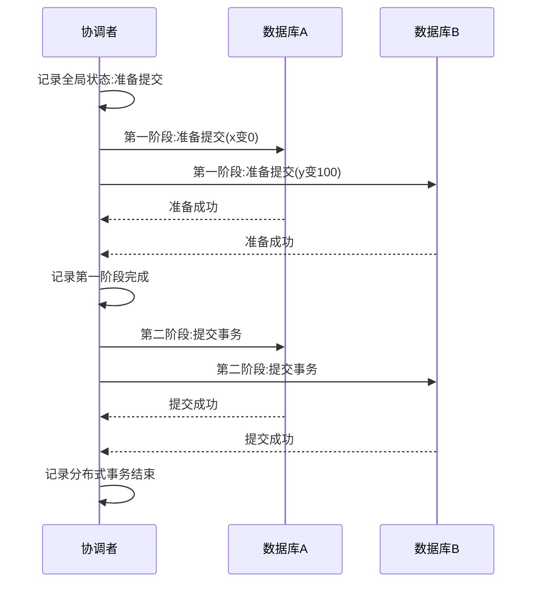
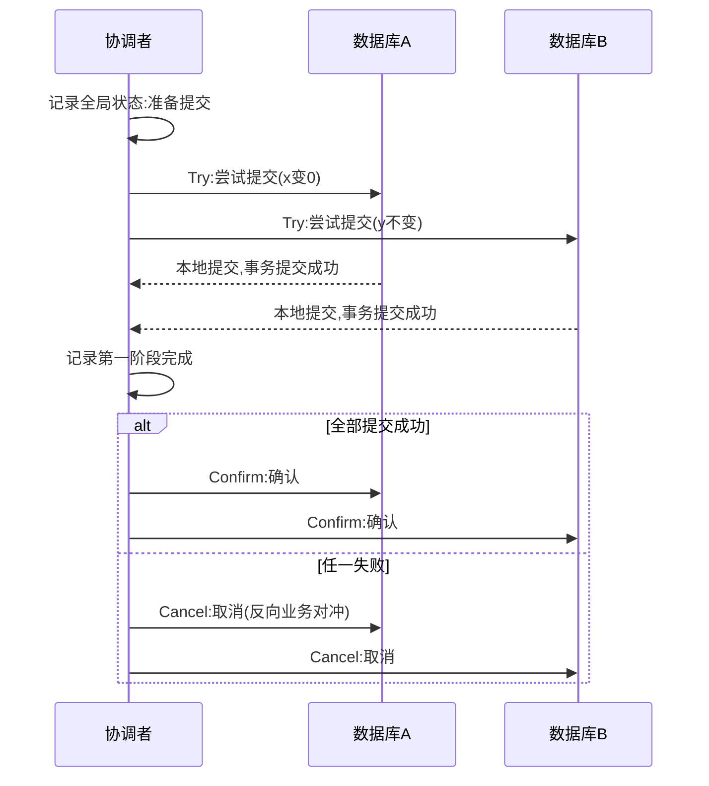

## 一句话总结
在多机、数据不复制(无容灾)的场景下，把各节点局部的事务能力汇集起来做集中决策，就得到分布式事务(分布式可串行化)。两条主流路线：数据库底层的 2PC 与业务上层的 TCC，共同支柱是协调者，但协调者本身构成单点。

## 知识导图
- 分布式事务
  - 核心思路
    - 汇集局部信息集中决策
    - 单机事务保证全局事务
  - 两阶段提交 2PC
    - 假设
      - 节点间无直接交流
      - 协调者唯一通信角色
      - 网络可丢指令与回执
    - 协议流程
      - 一:准备提交(预处理)
      - 二:统一提交或回滚
    - 数据库新增准备成功态
    - 成本
      - 至少两次网络往返
      - 两阶段间全程持锁
  - TCC
    - Try-Confirm-Cancel
    - 业务系统自管进度
    - 每阶段是完整本地事务
    - 取消是业务补偿非回滚
    - 业务需写正反两套
    - 中间态短暂少钱
    - 异常三加强
      - 允许空回滚
      - 空回滚留记录
      - 防悬挂
  - 正确性反思
    - 协调者库承载全局能力
    - 中间态靠最终一致性
    - 协调者单点问题

## 核心概念
- **分布式事务（Distributed Transaction）**：跨多个独立数据库的事务，目标是让整体表现如一个可串行化的事务。实现思路是用单机事务的正确性支撑全局事务的正确性。
- **协调者（Coordinator）**：唯一与所有参与机器通信、收集局部状态并做全局决策的角色，可以是一台独立机器，也可以是集群中的一员。协调者的本地数据库保存全局事务状态，其事务能力决定整个分布式事务的能力。
- **2PC（两阶段提交）**：数据库级分布式事务。第一阶段协调者发"准备提交"，各节点做预处理(加锁、改数据)但不提交，返回准备结果；第二阶段按全局结果统一下发提交或回滚。前提假设：节点间无直接交流、网络可能丢消息或回执。
- **准备成功状态**：为支持 2PC，单机数据库在"开始"与"完成"之外新增的中间事务状态——预处理完成但未提交，所以第二阶段"回滚"并不违反已提交事务不可回滚的原则。
- **TCC（Try-Confirm-Cancel）**：业务层分布式事务。Try 阶段各节点执行并真正提交本地事务并上报；Confirm 阶段做确认动作；Cancel 阶段用反向业务对冲第一阶段的业务效果。Cancel 是业务补偿(事务补偿)，不是数据库回滚，因此每个业务要实现正反两套。
- **空回滚**：允许对"根本没收到 Try"的事务执行 Cancel(取消一个不存在的事务)，并在系统中留下记录；此后迟到的 Try 看到该记录必须失败——这就是防悬挂。三者合起来解决 Try 与 Cancel 消息乱序问题。

## 核心要点
1. 分布式环境的出发点：各节点只有局部可串行化信息，需要协调者汇集后集中决策。
2. 2PC 至少需要两次网络往返，这是无法压缩的时间成本。
3. 2PC 第一阶段不提交事务，两阶段之间所有相关数据都要持锁，锁持有时间可能很长。
4. 出现任何一台机器准备失败或长时间无响应，全局事务统一回滚。
5. TCC 每个阶段都是完整的本地数据库事务，锁持有时间短，代价是业务系统必须感知分布式事务并实现三个方法。
6. TCC 微观不原子：转账例中第一阶段结束时 x、y 均为 0，系统瞬间"少了 100 元"，靠第二阶段补回；协调者全局库记录的中间状态保证了最终正确。
7. 宏观看，TCC 就是金融顶层架构：先通知所有系统做事(第一阶段)，再通过第二阶段对结果调整，对账系统正是第二阶段协调者的代表。
8. Try 与 Cancel 可能乱序(节点先收到取消后收到尝试)，业务必须做空回滚、空回滚留痕、防悬挂三重加强。
9. 2PC 也有同样的乱序问题，但被封装在数据库底层解决，不暴露给业务。
10. 协调者收集信息与执行事务是先后两个过程，中间状态不一致靠最终一致性收敛。
11. 协调者的全局事务数据库一旦损坏，整个分布式事务无法继续——这是本讲遗留的单点问题，由后续共识算法解决。

## 架构与流程
2PC 全局提交流程(协调者写全局事务状态→准备提交→记录成功→统一下发):

TCC 流程(第一阶段各节点本地提交后上报,第二阶段确认或取消):

## 关键对比
| 方案 | 前提/层次 | 第一阶段 | 保证 | 代价 |
| --- | --- | --- | --- | --- |
| 2PC | 数据库底层实现 | 预处理但不提交,停在准备成功态 | 全局原子提交/回滚,业务无感 | 两次网络往返;两阶段间长持锁;需改造数据库 |
| TCC | 业务上层实现 | 执行并真正提交本地事务 | 加锁时间短,各阶段独立提交 | 业务写正反两套;中间态暴露;需空回滚/防悬挂 |
| 单机事务 | 单库 | — | 强隔离(可串行化/快照隔离) | 仅覆盖本机,跨库失效 |

TCC 与 2PC 的关键差异：2PC 只有第二阶段结束后本地事务才真正结束，TCC 每阶段都是完整提交的本地事务。

## 易混与坑
- "已提交事务不能回滚"的悖论：2PC 第二阶段回滚并不违规，因为第一阶段事务从未提交，只是到达"准备成功"状态。
- TCC 的 Cancel 不是事务回滚，而是用一个反向业务对冲正向业务；照搬回滚思维会导致实现错误。
- 教科书说"转账必须是原子操作"是宏观结论；微观上 TCC 有多个原子步骤和可见的中间不一致状态，最终正确即可。
- 异常处理最复杂的情况是节点压根没收到第一阶段消息，稍后又收到第二阶段消息——这是乱序而非故障。
- 协调者全局库丢失数据不必然灾难：多数情况下可根据各节点状态反推全局事务进展(思考题线索)。

## 自测问题
- 2PC 两个阶段各自做什么？什么条件下进入回滚？（阶段一准备提交并反馈；阶段二统一下发提交或回滚；任一准备失败或长时间无响应即回滚）
- 为什么 2PC 需要数据库新增"准备成功"状态？（第一阶段不提交也不能直接丢弃，需要一个未完成的中间事务状态，第二阶段凭此提交或回滚）
- TCC 相对 2PC 的优缺点是什么？（每阶段完整本地事务、锁时间短；代价是业务双份实现、中间态可见、需处理空回滚与防悬挂）
- TCC 的取消为什么不能叫回滚？（Try 阶段事务已真正提交，数据库层面不可回滚，只能用反向业务做补偿）
- 协调者的单点问题指什么？（协调者全局事务数据库保存全部分布式事务状态，它一出问题全局事务就无法决策）
