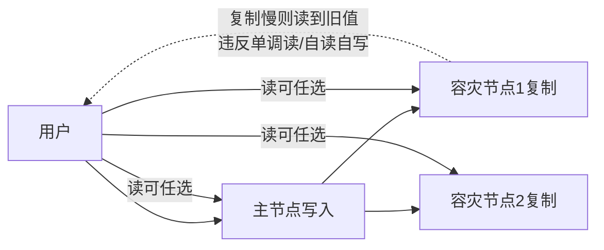

## 一句话总结
数据一旦复制到多处(容灾)，前两讲的集中控制模型失效。本讲批判性梳理 CAP，建立有容灾下的一致性分级：最终一致性、四种并列的会话一致性、最重要的线性一致性，以及把线性一致性与可串行化合体而成的最强级别——严格可串行化；并给出按业务选级的决策思路。

## 知识导图
- 容灾下一致性
  - CAP 辨析
    - 脑裂时二选一 CP/AP
    - 一致性指线性一致性
    - 定义笼统不建议常用
  - 最终一致性
    - 可见性:修改被副本反映
    - 最终=极限时间收敛
    - 缺工程定义指导有限
  - 会话一致性四种
    - 单调写一致
      - 各节点写序与用户一致
    - 单调读一致
      - 新读不得读到旧值
    - 自读自写
      - 读回全部历史写入
    - 先读后写
      - 跨会话写因果定序
    - 四者并列无强弱
  - 线性一致性
    - 分布式版可串行化
    - 重排操作至无重叠
    - 不重叠者先后不可反
    - 再做业务正确性验证
  - 严格可串行化
    - 线性一致性+可串行化
    - 唯一真实时间串行序
    - 效率极低很少用
  - 选级思路
    - 单机选快照隔离
    - 单会话三类保证
    - 多会话先读后写
    - 高要求线性一致性
    - 分库分表加分布式事务

## 核心概念
- **分区容错性（Partition Tolerance）**：网络故障把连通的机器割裂成独立部分，即脑裂。CAP 的真实含义是在脑裂发生后只能在一致性与可用性中二选一(CP 或 AP)，而不是流传甚广的"三选二"。
- **可见性（Visible）**：机器 A 上的修改经过一段时间反映到机器 B 上，即该修改在 B 可见；之后就能在 B 上使用该结果。
- **最终一致性（Eventual Consistency）**：修改在所有机器上最终都可见。"最终"借数学极限概念——时间趋于无穷时未复制到数据的机器数降为零；但对"多久算最终"没有工程可用的定义，指导意义有限。
- **会话（Session）**：用户的唯一标识符，是客户端概念而非服务端概念。容灾下同一用户的请求会落到不同机器，需要保证体验与单机一致，因此引出四种会话一致性。
- **单调写一致（Monotonic Write）**：所有节点记录的写入顺序与用户写入顺序完全一致。
- **单调读一致（Monotonic Read）**：不是要求读顺序一致，而是与写有关——同一用户后一次读不能读到比前一次读更旧的值。
- **自读自写（Read Your Write）**：能读回自己过去写入的全部值，要求读节点保存该会话的全部写入记录；但"写都完成了"不等于"写顺序正确"，需配合单调写。
- **先读后写（Write Follow Reads）**：唯一跨会话的一致性。若读到别人的写，则自己的写必须定序在那个写之后，保证因果先后。
- **线性一致性（Linearizability）**：分布式系统最重要的一致性，可视为分布式版的可串行化。要求能把所有操作按时间重排成互不重叠的顺序执行；未重叠的操作先后顺序不可颠倒；重排后还需按业务逻辑验证结果正确，全部排列都错才算违反。
- **严格可串行化（Strict Serializability）**：可线性化 + 可串行化。要求事务等价于唯一一个串行顺序——原事务结束越早，在串行序中越靠前，消除了可串行化"某个顺序"的随机性；代价是效率极低，很少使用。

## 核心要点
1. 容灾=数据多副本，此时单机与多机无容灾的结论都不适用，需要新理论。
2. CAP 不是三选二：分区容错是背景条件，真正可选的只有 C 和 A 之一。
3. CAP 对"一致性"没有明确定义(实指线性一致性)，把丰富的中间选择压成单选，学术界已不建议在架构讨论中使用。
4. 异步消息架构天然宣称最终一致性，但"最终"无工程定义，描述力同样有限。
5. 四种会话一致性彼此并列，没有高低强弱之分，按需组合。
6. 单调写是"各节点写序正确"；单调读是"读不到更旧的值"；自读自写是"读回全部历史写"；先读后写是"跨会话写因果"。
7. 自读自写只保证写入完成，不保证写入顺序，与单调写互补。
8. 线性一致性分析三步：重排重叠操作→保持非重叠操作先后→按业务逻辑验证串行结果。
9. 严格可串行化规定串行顺序唯一且符合真实时间先后，是分布式下最强一致性。
10. 简化容灾模型：写主节点、主节点复制到备份，读可落在主或任意备份，一致性差异由此产生。
11. 选级路线：单机→快照隔离；只保单会话→单调读/写+自读自写；跨会话→先读后写；高正确性→线性一致性；分库分表→每个容灾集群先线性一致、再用 TCC/2PL 做分布式事务。

## 架构与流程

## 关键对比
| 级别名 | 前提/场景 | 保证 | 代价 |
| --- | --- | --- | --- |
| 最终一致性 | 异步复制架构 | 极限时间所有副本可见 | 窗口期读到旧值，无工程时限 |
| 单调写一致 | 同一会话多次写 | 全节点写序与用户一致 | 复制必须保序 |
| 单调读一致 | 同一会话跨副本读 | 后读不旧于前读 | 读副本选择受限 |
| 自读自写 | 同一会话读自己的写 | 读回全部历史写入 | 节点需保存会话全部写入 |
| 先读后写 | 跨会话交互 | 写序遵循读到的因果 | 跨会话追踪成本 |
| 线性一致性 | 有容灾集群的高要求 | 全部操作可排全局序 | 实现需共识算法，复杂 |
| 严格可串行化 | 分布式事务最强要求 | 唯一真实时间串行序 | 效率极低，很少用 |

## 易混与坑
- CAP"三选二"是流传最广的误读；正确表述是脑裂前提下的 CP/AP 二选一。
- CAP 的一致性就是线性一致性，但它没说出口，造成大量歧义。
- 单调读不约束"读的顺序"，它约束的是"读相对写的新旧"；名称极具误导性。
- 自读自写与写入"完成"是两回事，顺序正确必须另靠单调写补足。
- 三个"强"的层次：可串行化管事务(顺序可任选)、线性一致性管操作(全局可排序)、严格可串行化管事务且顺序唯一，不要混用。
- 同一讲中的四个会话一致性是并列关系，不存在谁包含谁。
- 前两讲的结论(集中决策、单点控制)在多副本场景下整体失效，不要套用。

## 自测问题
- CAP 为什么不是三选二？它的一致性实际指什么？（分区容错是故障前提，只能 CP/AP 二选一；一致性实指线性一致性）
- 线性一致性的定义包含哪几步？（重排操作消除时间重叠、非重叠操作先后不可反、按业务逻辑验证串行结果是否合理）
- 自读自写为什么还需要单调写配合？（自读自写只保证所有写入都已完成，不保证各节点写入顺序一致）
- 先读后写与其他三种会话一致性的本质区别？（它是唯一跨会话的一致性，约束两个用户间的写因果顺序）
- 分布式严格可串行化由什么组成？为什么不常用？（可线性化+可串行化，串行顺序唯一且随真实时间；效率极低）
