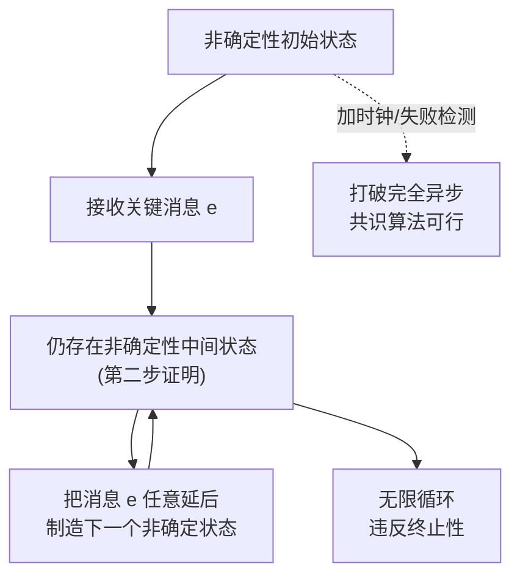

## 一句话总结
本讲讲解金融级架构师必须知道的 FLP 结论(1985 年 Fisher/Lynch/Patterson)：在完全异步、且至少一台机器可能出故障的分布式系统里，不存在非随机的共识算法。破局方法只有一个——让"完全异步"失效，即引入时钟做失败检测，这正是 Paxos/Raft 都带超时机制的理论根源。

## 知识导图
- FLP 不可能性结论
  - 结论表述
    - 完全异步+一台可能故障
    - 不存在非随机共识
    - 破除任一前提即可
    - 加时钟检测消息丢失
  - 系统定义
    - 机器
      - 至少三台二元状态
      - 改状态/发消息/输出一次
      - 逻辑正确非拜占庭
      - 算法非随机
    - 共识三条件
      - 终止性
      - 一致性
      - 有效性
    - 消息假设
      - 发送异步无时限
      - 队列完美不丢不重
      - 接收顺序随机
  - 三步反证
    - 一:存在非确定初始状态
      - 逐台变值构造相邻态
      - 相邻态结果依赖单机存亡
    - 二:非确定状态可延续
      - 关键消息可任意延迟
      - 接收方异同皆有矛盾
    - 三:无限构造循环
      - 永不收敛违反终止性
  - 破局:失败检测
    - 完整性强/弱
    - 准确性强/弱
    - 弱检测即可支撑共识
    - 时钟是充要条件

## 核心概念
- **FLP 结论**：《Impossibility of Distributed Consensus with One Faulty Process》确立的不可能性定理(2001 年获 Dijkstra 最具影响力论文奖)。完全异步系统中只要有机器可能故障，就不存在非随机的共识算法。
- **终止性（Termination）**：每个仍正常运行的机器最终都要确定唯一结果，一个不落；结果一旦做出不可更改；对故障机器无任何要求。
- **一致性（Agreement）**：所有还活着的机器输出的结果完全相同(全 0 或全 1)。
- **有效性（Validity）**：每个可能的值都可能成为共识结果。它排除了"永远输出 0"这类平凡算法——那虽满足终止与一致，却毫无意义。
- **确定性/非确定性状态**：若能从某状态预先算出共识结果，该状态是确定性的；若结果取决于某台机器是否在线，则是非确定性的。
- **路径**：系统状态变化的顺序，相邻两次状态变化之间恰好是新接收的一条消息。
- **失败检测器**：能判断某台机器是否出问题的机制(由时钟实现)，具有完整性与准确性两个属性，各分强弱共四种；后两篇 1996 年论文证明：即使很弱的失败检测也足以实现共识，而"能最终做准确判断的不准确时钟"是共识存在的充要条件。

## 核心要点
1. 结论的两个前提"完全异步"与"至少一台机器可能故障"缺一不可，推翻任何一个即存在共识算法。
2. 机器无法保证永不故障，所以唯一突破口是消除完全异步：给机器加时钟判断消息是否丢失。
3. Paxos、Raft 内置消息超时判断，正是绕开 FLP 的现实手段——理论不存在，现实可行。
4. 机器模型假设：至少 3 台、二元初始状态、只做改状态/发消息/输出一次三件事、逻辑正确(非拜占庭)、算法非随机。
5. 消息模型假设：发送与接收均异步且无时间保证，但队列本身完美——不丢消息、每条只被处理一次、接收顺序随机；队列空时返回空消息。
6. 证明第一步：把结果为 0 与 1 的两个初始状态逐台机器地改值逼近，必然出现相邻两个状态只差一台机器而结果相反；若这台机器从头死机，两状态实际相同却须给出相反结果——矛盾，故必存在非确定性初始状态。
7. 第二步：利用异步消息"接收时间可任意延迟"，把关键消息 e 往后挪；无论消息 e 与 f 的接收方相同还是不同，假设"中间状态全确定"都会推出矛盾，所以非确定性可以在中间状态延续。
8. 第三步：从非确定初始状态出发，每到一个非确定状态就把消息 e 挪后制造下一个非确定状态，循环无穷，违反终止性——于是任何共识算法都不存在。
9. 反证法从"所有初始状态都可预判结果"出发，逐层推出矛盾，是本讲最精妙的部分。
10. 例子的关键差异：C 一直运行但不输出(违反终止性，无共识) vs C 死机(对故障机器无要求，反而达成共识)。

## 架构与流程

## 关键对比
| 情形 | 系统条件 | 是否存在共识 | 说明 |
| --- | --- | --- | --- |
| 完全异步+有故障 | 无时钟、机器可能宕机 | 不存在(非随机算法) | FLP 结论本体 |
| 非完全异步 | 有时钟/失败检测 | 存在 | Paxos/Raft 靠超时实现 |
| 强检测 vs 弱检测 | 完整性×准确性四档 | 弱检测即可实现共识 | 时钟为充要条件 |

失败检测器两属性：完整性(所有/一些正确节点最终怀疑每个出错节点)、准确性(所有/一些正确节点不会被误怀疑)。

## 易混与坑
- "不存在共识算法"不是绝对论断：它有精确前提，现实系统加超时即可绕开，不要把它当成"分布式注定不可能"。
- 本讲假设非拜占庭(机器不撒谎、不攻击算法)，与区块链/比特币解决的拜占庭问题不同，不要混谈。
- 共识算法的"非随机"限定是为了结果可复现，随机算法不在证明范围内。
- 消息队列"完美"是刻意的理想化假设：不丢、只处理一次、接收随机序——现实中不存在，但证明聚焦分布式本身而非消息系统。
- 终止性只约束还活着的机器；一台机器"活着却不输出"与"死了"在共识判定上天差地别。
- 队列为空时返回的空消息同样可以触发机器改变状态，容易被忽略。

## 自测问题
- FLP 结论的精确表述是什么？两个前提是什么？（完全异步且至少一台机器可能故障时，不存在非随机共识算法）
- 共识三条件分别约束什么？有效性为什么必要？（终止性:活着的机器最终唯一输出；一致性:输出全相同；有效性:排除恒定输出的平凡算法）
- 三步证明分别证明什么？（存在非确定初始状态；非确定状态可延续到中间状态；无限延续违反终止性）
- 为什么异步消息的"可任意延迟"是证明的核心？（允许把关键消息挪后，不断制造新的非确定状态，使系统永不收敛）
- 现实中的共识算法如何绕开 FLP？（引入时钟做失败检测/超时判断，消除完全异步前提）
