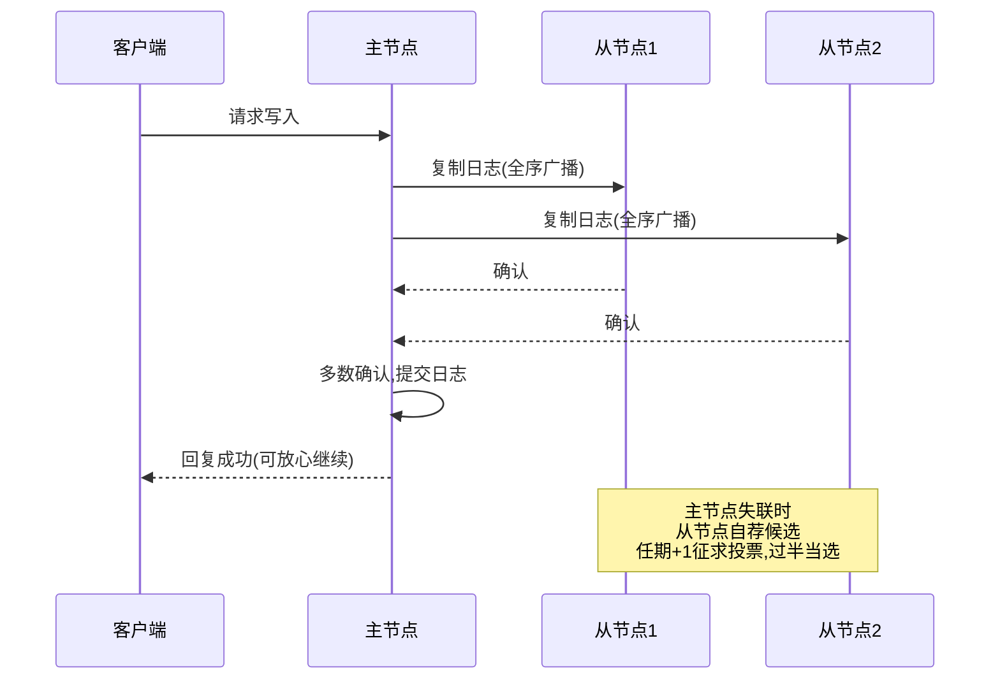
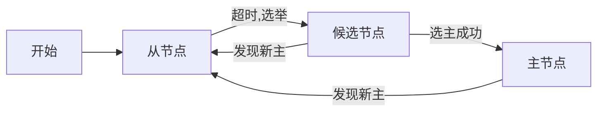

## 一句话总结
Raft(2014)是通俗易懂的共识算法，通俗结论是：只要多数机器在线，集群内文件就完全一致。它一面解决文件同步，一面天然实现全序广播与线性化存储——三者理论等价；用好 Raft 的关键是客户端只访问主节点、把"不确定"当失败重试并依赖服务端去重，其内部骨架是节点三状态与单调递增的任期。

## 知识导图
- Raft 共识算法
  - 能解决什么
    - 文件同步
      - 多数在线即文件一致
      - 已确认段安全可用
      - 同步中内容不可用
      - 宜存重要小数据
    - 全序广播
      - 消息一个不丢
      - 各机顺序完全一致
      - 数据库日志容灾
      - 会计账本备份
    - 线性化存储
      - 可线性化的实现
      - 分布式锁
      - 锁服务支撑分布式事务
  - 三者等价
    - 共识即全序广播
    - 全序广播即线性化存储
    - 锁换序互推
    - 借分布式状态机
  - 使用要点
    - 客户端
      - 只访问主节点
      - 失联轮询找主
      - 三态:成功/失败/不确定
      - 不确定按失败重发
      - 服务端必须去重
    - 服务端
      - 多数在线即可工作
      - 容灾力度可配置
  - 核心概念
    - 节点三状态
      - 主节点
      - 从节点
      - 候选节点
    - 任期
      - 单调递增正整数
      - 心跳压制从节点
      - 失主触发选主
      - 过半同意当选

## 核心概念
- **共识（Consensus）**：多台机器就结论达成统一。通俗版：能在多台机器间同步一个内容不断增加的文件；保证是——只要多数机器正常工作，这些机器上的文件完全一样。
- **全序广播（Total Order Broadcast）**：两个条件——消息一个不丢(某机出现的消息其他机器都有)，且所有机器记录的消息顺序完全一致。等于不仅要同步文件，还要同步文件内容的顺序。
- **线性化存储（Linearizable Storage）**：第 14 讲"可线性化"理论的工程实现——一个分布式存储集群，用户在其上的操作序列可重排为无重叠的顺序执行且结果合理。标志性应用是分布式锁：在一台机器上拿到锁，等于在所有机器上都拿到了锁。
- **分布式状态机**：事件溯源(第 7 讲)的分布式版本。命令经全序广播到达各机，各机自动机判定命令合理性后生成事件、更新状态，用于从全序广播构造线性化存储。
- **主从节点（Leader and Follower）**：任一时刻集群最多一个主节点，是唯一处理请求的节点，负责把请求同步给从节点；主从角色会变化，但同一时刻最多一个主。
- **候选节点（Candidate）**：未来的主节点。节点发现集群疑似无主时自荐为候选并发起选主；系统中可同时存在多个候选。
- **任期（Term）**：不断递增的正整数，历任主节点任期严格递增。正常时主节点用心跳广播任期压制其他节点保持从属；主节点失联时各节点自荐候选，把最后任期数加一征求投票，获半数以上同意即当选为主。

## 核心要点
1. 文件被分为两段：已确认同步的内容可放心使用；同步中的内容是临时内容，暂不可用。
2. 共识适合同步"重要但数据量不大"的数据：云计算机器清单、配置信息、路由信息等。
3. 全序广播的典型场景：数据库日志容灾、会计账本备份——顺序错误不可接受的场合；区块链本质是共识生成的分布式账本，但它假设节点恶意(拜占庭)，Raft 假设非恶意，资源消耗更低速度更快。
4. 重要结论：共识 ≡ 全序广播 ≡ 线性化存储，三者两两等价、可互相构造。
5. 线性化存储→全序广播：广播前先取分布式锁，消息送达所有机器后释放锁。
6. 全序广播→线性化存储：把加锁命令经全序广播分发，各机状态机判定后生成"获得锁"事件并更新状态。
7. 客户端第一守则：永远只访问主节点；主失联就轮询其余节点，好的实现会让从节点提示"它心中的主节点"，循提示可快速找到真主。
8. Raft 反馈三态：成功=消息已通过全序广播保存到所有正常机器，可继续；失败=多半是对方不再是主节点，重新找主；无响应(不确定)=假设失败重发，因此服务端必须有去重能力。
9. 服务端只需多数节点在线即可工作，Raft 天然带容灾能力，容灾力度按需选择。
10. Raft 本地维护自增不减的日志文件，已同步部分安全、同步中部分临时，与文件同步的两段论一致。
11. 金融启示：核心组件与周边数据系统都需要线性一致性——底层用线性化存储支撑分布式锁与分布式事务，上层用分布式状态机保证业务多机一致。
12. 思考题呼应：协调者单点问题本质就是"单点存储需要共识"；解法是用 Raft 这类共识算法为协调者的全局事务数据库做容灾。

## 架构与流程
客户端使用 Raft 的请求流程(只访问主节点,主节点经全序广播同步,多数确认后回复成功):

节点三状态状态机(超时触发选举,发现新主回归从属):

## 关键对比
| 能力 | 保证 | 典型用途 |
| --- | --- | --- |
| 文件同步 | 多数在线时各机文件一致 | 配置、路由等重要小数据 |
| 全序广播 | 消息不丢且全机顺序一致 | 数据库日志容灾、会计账本、区块链 |
| 线性化存储 | 操作可排全序、结果合理 | 分布式锁、容灾锁服务、分布式事务 |
| 拜占庭共识(区块链) | 容忍恶意节点 | 加密货币；资源消耗大 |
| Raft(非拜占庭) | 假设节点不撒谎 | 更少资源达成共识，更快 |

## 易混与坑
- "成功"的精确含义：不是本机收到，而是已通过全序广播保存到所有正常机器——只有此时才能继续下一条。
- "不确定"必须按失败处理并重发，重复请求不可避免，服务端去重(幂等)不是可选项而是必需品。
- 主节点角色随时可能变化，客户端不能缓存"谁是主"太久，要有找主与跟随提示的机制。
- Raft 的可用前提是多数节点在线，不是全部在线；理解容灾力度按"多数存活"计算。
- 候选节点可以同时存在多个，"候选"不等于"将当选"；真正的唯一性约束是同一时刻至多一个主。
- 心跳(压制)与选主是同一枚硬币的两面：压制消失才触发选主，任期递增保证旧主无法复辟。
- 勿把 Raft 与区块链共识混为一谈：后者解决拜占庭问题，假设前提不同。

## 自测问题
- 共识算法通俗地解决什么问题？给出的确切结论是什么？（跨机同步不断增加的文件；只要多数机器正常工作，机器上的文件完全一致）
- 全序广播有哪两个条件？适合什么场景？（消息不丢、全机顺序一致；数据库日志容灾、会计账本备份）
- 为什么共识、全序广播、线性化存储可视为同一件事？各自怎么互推？（三者等价；线性化存储借分布式锁广播消息、全序广播借分布式状态机判定加锁命令）
- 客户端使用 Raft 的三条纪律是什么？（只访问主节点；失联轮询找主并跟随提示；不确定一律按失败重发且依赖服务端去重）
- 任期机制如何同时实现压制与选主？（主用心跳广播递增任期压制从节点；失主后节点自荐候选、任期+1 征求投票，半数以上同意即当选）
