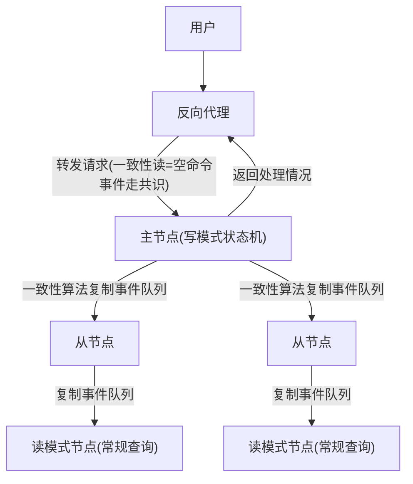

## 一句话总结
把单机事件溯源架构扩展到多机：用共识算法复制**事件队列**构成复制状态机实现容灾，再依次解决对外通讯（反向代理）、数据查询（读模式与一致性读）、分库（路由升级与协调者容灾）问题。

## 知识导图
- 分布式事件溯源
  - 多机容灾
    - 线性一致性要求主节点
    - 选主解决单点故障
    - 全序广播保状态一致
  - 复制状态机
    - 复制事件队列非命令
    - 命令转事件有随机性
    - 仅主节点对外通讯
    - 反向代理隐藏集群
  - 数据查询
    - 常规查询
      - 读模式复制事件队列
      - 任一已同步节点可为源
      - 主节点新但压力大
      - 从节点压力小有延时
    - 一致性读
      - 查询发往写节点
      - 空命令事件走共识
      - 达到线性一致性
  - 分库
    - 反向代理升级为路由
    - 跨库事务需协调者
    - 操作日志共识同步容灾

## 核心概念
- **复制状态机**：用共识算法把同一份日志（这里是事件队列）按相同顺序复制到多台机器并各自执行，各节点状态完全一致；是有状态系统容灾的标准形态。
- **全序广播**：所有节点以相同顺序看到相同消息序列；它是"替换节点与主节点完全一致"的机制基础，由一致性算法提供。
- **反向代理**：集群对用户的统一代表，负责维持 TCP 长连接、转发请求与回传结果；用它向用户隐藏"事件溯源是一组机器、且主节点可能中途更换"的细节。
- **读模式状态机**：只复制事件队列从而复制出状态、专门服务查询的节点；分布式下可从任一已同步节点获取事件。
- **一致性读（Consistent Read）**：把查询当作空的命令和事件发给写节点、走共识排序，用线性一致性覆盖读模式满足不了的单调读一致与自读自写。
- **分库路由**：分库后各节点只能处理部分业务，反向代理必须升级为维护全局路由信息的路由节点。

## 核心要点
1. 线性一致性容灾隐含三个要求：集群由主节点提供服务、主节点故障后要选主、新主与旧主完全一致（全序广播）——所以有状态系统容灾必然选共识算法。
2. 要复制的是**事件队列**而非命令队列：命令变事件的过程有随机性，换主后同样的命令可能生成不同事件；只有命令到事件完全无随机性时才能复制命令队列。
3. 只有主节点能对外通讯（返回执行结果）；从节点只复制事件队列、更新内部状态。
4. 常规查询从任一节点复制事件都正确（Raft 保证已同步数据正确）；从主节点取数据最新但加重压力，从从节点取压力小但延时大、甚至长期落后——按需取舍。
5. 读模式查询满足不了会话的单调读一致与自读自写；一致性读与写流程完全一样，只是命令事件为空操作，靠共识的线性排序保证读写顺序正确。
6. 分库后系统出现多个不同状态的节点，反向代理要变成路由，内部维护全局路由信息、按业务逻辑分发消息。
7. 2PC/TCC 的协调者是单点；把数据库操作日志经共识算法同步到多机、由日志恢复状态，即可实现协调者容灾——这也是常见分布式数据库的实现方式。

## 架构与流程

## 关键对比
| 维度 | 常规查询（读模式） | 一致性读 |
| --- | --- | --- |
| 实现 | 从节点复制事件队列重建状态 | 查询作为空命令/事件走写节点共识 |
| 一致性级别 | 弱一致，不满足单调读/自读自写 | 线性一致性 |
| 负载 | 可分摊到从节点 | 全部落到主节点 |
| 适用 | 一般查询、数据分析 | 会话内读写顺序敏感的操作 |

## 易混与坑
- 误区：复制命令队列就能容灾。错在忽略命令→事件的随机性，换主后状态会分叉。
- "任何节点都能复制"不等于数据随意：只有被标记为已同步的数据才保证正确，不同节点同步进度不同。
- 一致性读不是新流程，本质和写完全一样，只是命令与事件什么都不做。
- 换主后原主节点与用户的连接会断开，这个复杂度应交给反向代理，而不是让客户端自己处理。

## 自测问题
- 为什么容灾要复制事件队列而不是命令队列？（命令转事件有随机性，同命令换主后可能生成不同事件；复制事件才能全序一致）
- 常规查询从主节点还是从节点复制事件？各自代价？（主节点最新但压力大；从节点压力小但延时大）
- 一致性读如何实现、达到什么级别？（查询作空命令/事件发写节点经共识排序，结果经反向代理返回；线性一致性）
- 分库后反向代理要怎么变？（升级为路由，维护全局路由信息）
- 分布式事务协调者的单点问题怎么解？（复制状态机：操作日志经共识算法同步到多机恢复状态）
