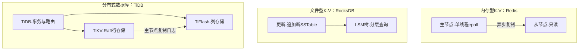

## 一句话总结
所有业务系统本质上都是数据系统；本讲用 Redis、RocksDB、Spanner、TiDB 四个代表方案，讲清分布式数据系统在不同环节的速度、正确性、稳定性取舍原理。

## 知识导图
- 分布式数据方案
  - Redis-内存K/V
    - 单线程加epoll提速
    - 异步主从备份
    - 牺牲会话一致性换速度
    - RDB快照与AOF日志
  - RocksDB-文件K/V
    - SSTable有序文件Map
    - LSM树分层查询
    - 追加写入速度极快
    - 查询延时呈锯齿
    - B+树延时平稳
  - Spanner
    - Paxos同步日志文件
    - 表本质是K/V结构
    - 主节点做分布式锁
    - 2PC协调者非单点
    - TrueTime原子钟
  - TiDB
    - TiKV行存Raft事务
    - TiFlash列存读模式
    - 读写分离各自优化
  - 架构取舍
    - 稳定性正确性速度不可兼得
    - 读写存储空间不可兼得

## 核心概念
- **SSTable**：存储在文件里的 Map，键为字符串且按升序排列；是最小的文件型存储单元。
- **LSM 树**：多个 SSTable 自上而下分层组成，查询从最上层往下逐层找；更新不改旧文件、只在最上面新建一个 SSTable，把"修改"变成"新增"，因此写极快、读偏慢。
- **RDB / AOF**：Redis 的两种本地备份——RDB 定期把内部状态快照到硬盘（快但两次快照间的数据无法恢复），AOF 实时追加操作日志（完整但持续写盘）。
- **日志即状态**：数据库操作日志可恢复状态，经共识算法（Paxos/Raft）全序广播同步到多机、各自回放，就得到分布式状态机；这是 Spanner 与 TiDB 的共同根基。
- **TiKV / TiFlash**：TiDB 把行存储（事务、LSM+Raft）与列存储（分析、B+树、读模式）拆成两个独立组件，分别优化写与分析。

## 核心要点
1. Redis 快在三招：单线程+epoll 避免多线程加锁冲突、异步主从备份减少返回延迟、RDB 定期快照牺牲完整性换速度。
2. Redis 异步主从+只读从节点满足不了单调读一致与自读自写；读操作走主节点可得线性一致，但前提是主节点不出故障——异步备份下主挂了会丢数据，集群整体并非线性一致。
3. LSM 树的真正价值：数据超过内存后仍能提供 K/V 查询能力且写入吞吐高；代价是查询要逐层找，延时呈锯齿（bloomfilter 只能缓解不能根治）。
4. 选型口诀：要求延时可控选 B+ 树，要求写入速度选 LSM 树。
5. 关系型表无论按列垂直划分（列名为键）还是按行水平划分（主键为键），最终存储都是 K/V 结构。
6. Spanner 的分布式锁与 2PC 协调者都由 Paxos 主节点承担，协调者天然有容灾能力、不再是单点。
7. TiDB 用 Raft 替代 Paxos（工程上更清晰易实现）；数据分析不需要一致性读，所以 TiFlash 只需常规查询，选择只从 TiKV 主节点复制日志以节省延时。
8. 总取舍：稳定性提高伴随速度下降，速度提高伴随正确性下降；读写都快需要多份存储。分布式环境下没有"正确"的架构，只有满足业务需求的合适架构。

## 架构与流程

## 关键对比
| 维度 | B+ 树 | LSM 树 |
| --- | --- | --- |
| 更新方式 | 原地修改文件 | 追加新建 SSTable |
| 写入速度 | 一般 | 极快 |
| 查询速度 | 好 | 慢、需逐层查找 |
| 延时形态 | 平稳 | 锯齿（偶发尖峰） |
| 适合场景 | 延时可控优先 | 写入吞吐优先 |

| 维度 | RDB | AOF |
| --- | --- | --- |
| 方式 | 定期快照整个状态 | 实时追加操作日志 |
| 速度 | 快（偶发写盘） | 慢（持续写盘） |
| 完整性 | 两次快照间数据丢失 | 高 |

## 易混与坑
- "Redis 是线性一致的"有前提：主节点不故障；异步备份机制下主节点损坏可能丢数据，集群整体达不到线性一致。
- 不要神化 LSM 写速度：它的赢面不是绝对速度（Redis 甚至可以不落盘），而是超内存数据量下的高写吞吐。
- Spanner 的价值在于第一个把成熟方案整合并证明可行，后来的方案普遍借鉴它，不是反过来。
- TiFlash 只从主节点复制是省延时的优化选择，不是共识要求；常规查询从任何已同步节点取都正确。

## 自测问题
- Redis 靠什么做到低延迟？分别牺牲了什么？（单线程+epoll、异步主从、RDB；牺牲单调读/自读自写与数据完整性）
- LSM 树为什么写快读慢？（更新变文件末尾追加；查询需自上而下逐层找，层多了出现锯齿延时）
- Spanner 如何让 2PC 协调者不成为单点？（协调者即 Paxos 主节点，本身具备共识容灾）
- TiDB 为什么要 TiFlash、它怎么同步数据？（列存优化分析场景；以读模式从 TiKV 主节点复制日志）
