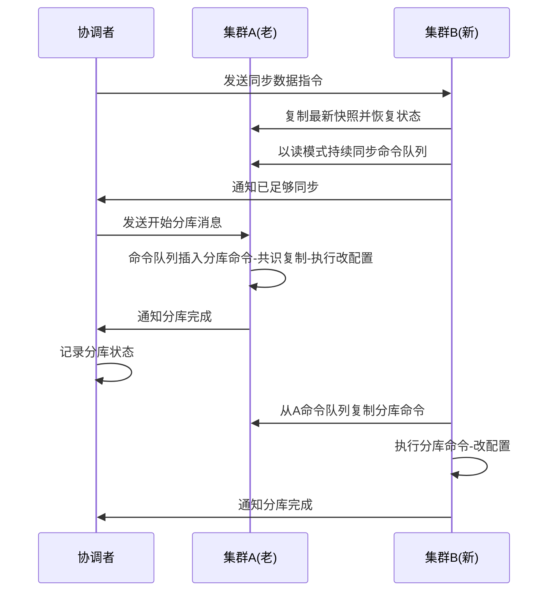

## 一句话总结
基于事件溯源架构实现不停机的动态分库：用快照解决存量数据复制、命令队列解决增量数据完整性、状态机计算能力保证实时状态一致，靠协调者与一条"分库命令"完成与业务无关、可自动化的拆分。

## 知识导图
- 动态分库
  - 架构目标
    - 停机时间最小化
    - 与业务尽量无关
    - 过程尽量自动化
  - 架构假设
    - 事件溯源命令队列
    - 状态机完全可重现
    - 快照支持定点恢复
  - 分库前
    - 新增集群B与协调者
    - 复制快照恢复状态
    - 读模式追赶命令队列
    - 差距几秒即算同步
  - 分库中
    - 协调者发分库命令
    - A改配置拒收B业务
    - B复制命令后启用
    - A全程在线不停机
  - 分库后
    - 上游靠错误重定向
    - 中间增加路由层
    - 下游协调者推送
    - 或解析分库命令

## 核心概念
- **协调者**：分库过程的自动化组件，记录当前分库阶段、向各节点发送指令，本地数据库维护全部分库描述信息。
- **分库命令**：写入命令队列的特殊命令，记录分库后 A/B 各自负责哪些业务；不涉及存储格式与增改逻辑，几乎与业务无关。
- **读模式追赶**：新集群 B 先复制老集群 A 的快照恢复到某时间点，再以 A 的读模式身份持续同步命令队列，把差距缩到几秒。
- **错误重定向**：集群收到不属于自己业务的消息时返回错误并给出正确去处提示，上游据此动态更新路由。

## 核心要点
1. 朴素方案（停业务→备份→切分→测试→重启）停机太久；用异步备份机可先补齐存量、停机后只补增量，但人工干预多、与业务数据保存方式强绑定、通用性低。
2. 核心思路一句话：快照管存量复制，命令队列管增量完整，状态机管实时一致。
3. 分库前要新增三组节点：老集群 A、新集群 B（都是共识集群）、协调者；B 恢复快照后即知道对应哪个时间点的事件位置。
4. 同步标准是"足够新"而非"完全一致"——A 一直在处理新业务，B 必有延时；一般数据差几秒即算同步好（可用日志时间戳或共识心跳时间戳判断）。
5. 只有 B 自己能判断是否同步完成，协调者可用推或拉的方式获取该状态。
6. 分库中：A 把分库命令写入命令队列并经共识复制到容灾节点；A 执行后改变内部配置、拒收属于 B 的业务并向用户报错；B 读到同一条命令同样执行并启用自己的业务；双方通知协调者。A 全程在线，无停机时间。
7. 对业务的唯一影响：B 同步到分库命令之前的窗口里，属于 B 的消息无人处理；因事先把差距压到几秒，影响约等于一次网络重发时间。
8. 分库后上游靠错误重定向发现新库；给每个上游都做动态路由成本高，通常在中间加一层路由，根据集群错误提示自动更新路由信息。
9. 分库后下游需要"找到所有集群"：被动方案由协调者推送分库信息（只有协调者需理解分库）；主动方案由下游解析事件流中的分库命令自行发现。下游系统类型多时，主动方案每个都要实现解析、开发量大。
10. 思考题要点：分库命令改的是内部配置，操作幂等，重复收到同一条命令不影响正确性。

## 架构与流程

## 关键对比
| 维度 | 上游系统 | 下游系统 |
| --- | --- | --- |
| 诉求 | 找到一个正确集群 | 找到所有集群 |
| 分库感知方式 | 错误重定向 | 无法靠报错感知 |
| 方案 | 自带动态路由或加路由层 | 协调者推送（被动）/解析分库命令（主动） |
| 成本 | 每个上游都要路由能力 | 主动方案需逐个实现解析 |

## 易混与坑
- 不要追求"完全同步"：A 在持续处理业务，B 永远有延时，达标线是差距缩小到几秒。
- 判断同步完成这件事只有 B 自己有资格，协调者只是推或拉地获取状态。
- 分库命令只记录"谁负责什么业务"，不含数据格式、新增还是修改等处理细节。
- 协调者并不直接指挥 B 的分库执行：B 是从命令队列里自然复制到分库命令的，这是流程能保持实时的关键。

## 自测问题
- 动态分库的三个架构目标？（尽量少停机、尽量与业务无关、尽量自动化）
- 存量与增量分别靠什么解决？（快照解决存量，命令队列解决增量，状态机保证一致性）
- 分库命令执行后 A、B 各发生什么？（A 改配置拒收 B 的业务并报错；B 改配置启用自己的业务；都通知协调者）
- 下游发现分库的两种方式及取舍？（协调者推送被动获知 vs 解析分库命令主动发现；下游类型多则主动方案开发成本大）
