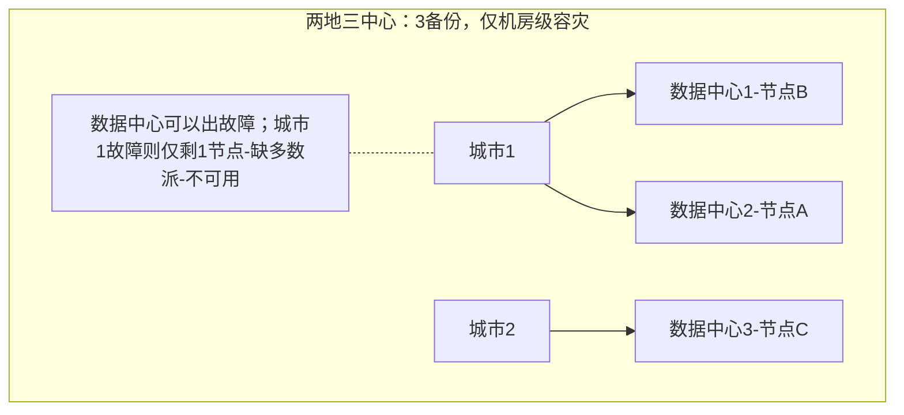
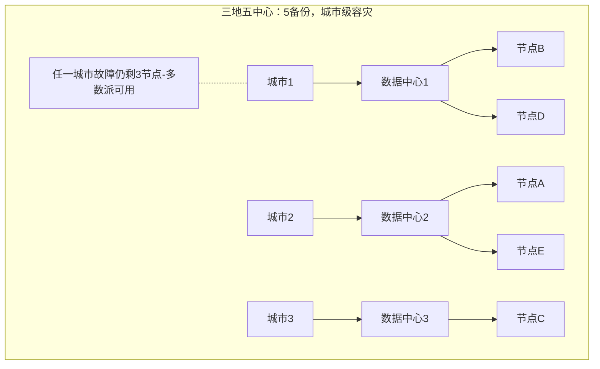

## 一句话总结
金融容灾的"正确"由 SLA 与事务原子性构成、且必须在成本间权衡；先解决发现问题（监控要抗伪报），再按 SOA 分层容灾：无状态靠调度与幂等，有状态与数据靠共识算法的两地三中心、三地五中心部署。

## 知识导图
- 跨机房容灾
  - 正确的定义
    - SLA限时恢复
    - 事务原子性要求
    - 服务正确性成本三角
  - 发现问题
    - 人工监控适用低SLA
    - 监控平台互相监控
    - 推拉取数权衡
    - 警惕监控伪报
  - 容灾过程
    - SOA三层架构
    - 无状态服务容灾
      - 调度到健康机房
      - 更新路由剔除故障
      - 消息重发要幂等
    - 有状态服务当数据节点
  - 数据容灾
    - 单节点容灾
      - 缓存与fsync风险
      - 企业级硬件电池
      - 断电视作单点故障
    - 多机房部署
      - 两地三中心机房级
      - 三地五中心城市级
    - 客户端正确找新主

## 核心概念
- **SLA（服务质量协议）**：规定一定时限内必须恢复服务；违约按合同金额赔偿，风险可控。
- **事务正确性（原子性）**：金额操作要么全成要么全不成；出错（半截过户、重复打款）带来不可控的经济风险，比 SLA 违约更危险。
- **监控伪报**：监控系统报某服务不可用，但服务实际正常运行（如防火墙配置错误导致状态和指令都发不通）；容灾处理必须在这种情形下仍然正确。
- **幂等性**：同一请求重复执行结果不变，靠消息内唯一标识或天然幂等的 K/V 结构实现，用来解决容灾期间的消息重发。
- **两地三中心**：3 个 Raft 节点分布在两个城市的 3 个数据中心（2+1），只能扛单数据中心故障。
- **三地五中心**：5 个节点基本平分到 3 个城市的数据中心，任一城市故障仍有多数派在线，达到城市级容灾。

## 核心要点
1. 正确容灾的两大要求：SLA（限时恢复）与事务 ACID 中的原子性；两者都要花钱，正确是相对的，要在服务质量、事务正确性、成本之间权衡。
2. SLA 违约赔偿金额可控；事务正确性出问题是不可控风险（百亿债券过户中断、工资重复打款）。
3. 业务量小、客户少、金额高且 SLA 低（几天到几个月）的金融业务，人工监控即可（如 Excel 里的资产证券化）。
4. 监控系统自身要容灾，但监控数据时效性强、允许部分丢失，性价比方案是本地异步备份+各数据中心的监控平台互相监控，不必照搬业务系统的高成本容灾。
5. 监控取数：推（心跳）实时但要求监控系统峰值能力高；拉（定期取）资源需求固定但延时更长——按业务 SLA 沟通选择。
6. SOA 三层：用户应用层、无状态服务层、数据层。无状态服务容灾基本靠调度重试落到健康机房，优化是及时更新路由、剔除故障机房。
7. 无状态层的真正风险是消息重发：服务可能处理成功但结果没送达（如防火墙问题），必须实现业务幂等。
8. 外汇/股票交易所这类低延时金融场景是有状态服务，容灾时当作数据节点处理。
9. 单节点容灾：数据先写 OS 缓存、再写硬件控制器缓存，fsync 也只到控制器缓存，断电仍可能丢数据；对策是企业级带电池硬盘，或像 Kafka 干脆不管、把断电当作单节点故障——"到什么程度取决于你有多少钱"。
10. 3 备份若 2+1 跨两个机房，只保单节点级容灾：机房 1 整体故障只剩 1 节点，Raft 缺多数派无法工作。
11. 服务端容灾做对即可保证数据正确，但客户端要在换主后用正确方式找到新主，才能压低容灾延时。

## 架构与流程

## 关键对比
| 部署方案 | 备份数 | 分布 | 可扛故障 | 容灾级别 |
| --- | --- | --- | --- | --- |
| 2+1 双机房 | 3 | 两机房 | 单节点 | 单节点级 |
| 两地三中心 | 3 | 两城三机房 | 单数据中心 | 机房级 |
| 三地五中心 | 5 | 三城五机房 | 城市级故障 | 城市级 |

| 维度 | 推（心跳） | 拉（定期取） |
| --- | --- | --- |
| 实时性 | 强 | 较弱 |
| 资源要求 | 峰值能力高 | 基本固定 |
| 适用 | 高 SLA 业务 | 按业务 SLA 折中 |

## 易混与坑
- 3 备份放在 2 个机房不等于机房容灾：多数派要求 2 节点在线，机房 1 挂掉后算法直接不可用。
- fsync 成功 ≠ 数据落盘：数据可能只在硬件控制器缓存里，断电照样丢。
- 监控平台不必套用业务系统容灾架构，因为监控数据可以部分丢失——不要为小概率数据中心级灾难付出高成本。
- 服务器端正确不等于整体正确：客户端找新主的行为直接影响恢复速度。

## 自测问题
- 正确容灾的两个维度是什么？哪个风险更不可控？（SLA 与事务原子性；事务正确性出问题风险不可控）
- 两地三中心与三地五中心分别能扛什么级别的故障？（机房级故障 / 城市级故障）
- 为什么监控数据本地异步备份就够？（监控数据时效衰减快、允许部分丢失，高成本容灾不划算）
- 单机断电丢数据的两个处理方向？（企业级带电池硬盘保落盘；或把断电当单节点故障处理，如 Kafka）
