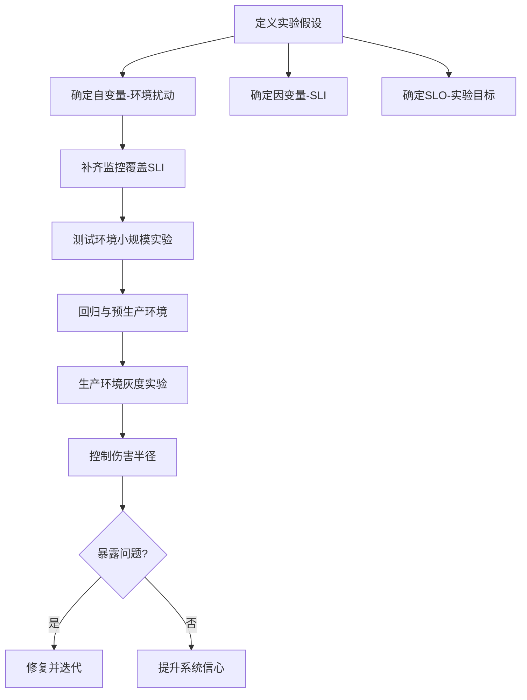

## 一句话总结
分布式系统无法从理论或实践上证明"一定不出错"，正确性本质是对系统不出大问题的置信度；混沌工程通过主动制造故障的统计实验提高发现问题的概率，从而提升对系统的信心。

## 知识导图
- 混沌工程
  - 正确性新思路
    - 形式化证明限有限
    - 证有不证无
    - 正确性是置信区间
  - 系统定义
    - 组成超三个易混沌
    - 行为非线性不可预测
    - 含软硬件与运维人员
  - 实验定义
    - 自变量可控扰动
    - 因变量受影响对象
    - 用假设不用断言
    - 区别于测试
  - 自变量分层
    - 硬件层
    - 操作系统层
    - 虚拟机层
    - 系统API与应用层
  - 因变量与SRE
    - SLA包含SLO与SLI
    - SLI是监控对象
    - SLO是目标值
  - 实验过程
    - 先补齐SLI监控
    - 环境逐级升级
    - 控制伤害半径
  - Jepsen测试
    - 专验分布式正确性

## 核心概念
- **证有不证无**：逻辑上只能证明问题存在（找到一只黑天鹅即可），无法穷举证明问题不存在；因此放弃证明"没有 bug"，改为证明"能找到 bug"。
- **置信区间**：正确性是概率概念——找 bug 成本超过收益时停止投入，此时"系统不太会出大问题"是统计意义上的信心，而非绝对保证。
- **混沌系统**：组成部分超过 3 个后行为趋向非线性（不可预测）；混沌工程的对象就是这类系统，且"系统"不只软件，还包括硬件、运维系统、监控系统与开发/运维/值班人员。
- **自变量/因变量/假设**：自变量是可控制的扰动（如拔掉硬盘），因变量是被自变量影响的对象（如告警、高可用），假设描述两者的影响关系。
- **伤害半径（Blast Radius）**：实验故障的影响范围，要控制得尽量小；实验从测试环境逐级升级到生产灰度。
- **Jepsen 测试**：面向分布式系统正确性的混沌测试，实验后收集各节点数据验证结果正确性；与混沌工程几乎一样，只是 SLO 定义在正确性（目标 100%）上。

## 核心要点
1. 形式化证明只能覆盖有限状态；Raft 涉及无限种可能，无法形式化证明正确；实现不可能比理论更正确，所以理论与实践都证不了"无错"。
2. 测试 vs 混沌实验：测试已知正确答案、目标是肯定正确性；混沌实验结果未知、目标是更好地理解系统，用假设而非断言。
3. 系统是由相互作用、相互依赖的组成部分构成的整体，本身又是更大系统的一部分；组成超过 3 个就很可能进入混沌状态。
4. 自变量按软件层次找：硬件（CPU/硬盘/网卡…）→操作系统（虚拟内存/文件系统/Socket/进程线程）→虚拟机（VMWare/Docker）→系统 API→应用程序（解释型语言还有运行时）。
5. 分层思维可迁移到新场景：云计算下从刀片、机柜、单数据中心到城市容灾集群逐层划分扰动对象。
6. 每个自变量定义自己的操作类型（硬盘慢/坏、断网/掉帧），定义越准确实验设计越精细。
7. SRE 负责定义与实现服务质量体系；SLA 包含 SLO 与 SLI——SLI 是监控对象（吞吐量、延时、性能），SLO 是指标目标（如高可用 5 个 9）。实验中 SLI 即因变量，SLO 即假设。
8. 实验前必须补齐覆盖所有 SLI 的监控：软件不可见，只能靠指标间接了解它的行为。
9. 实验逐级升级：测试环境→回归环境→预生产环境→生产环境灰度小规模；目的是理解生产环境的能力范围，不是故意搞坏它。
10. 暴露的问题要像测试 bug 一样修复；反复实验都未发现问题，则对系统正常情况下的正确性更有信心。
11. 作者实践：Raft 支付系统研发 3 个月、混沌测试一整年，最后一个 bug 半年后才发现；正确性是金融系统开发者的道德底线，要先做强再做大。

## 架构与流程

## 关键对比
| 维度 | 测试 | 混沌工程实验 |
| --- | --- | --- |
| 前提 | 已知正确答案 | 不知道会发生什么 |
| 目标 | 肯定正确性 | 更好地理解系统 |
| 结论形式 | 断言 | 假设 |
| 暴露问题后 | 修 bug | 同样要修复 |

## 易混与坑
- 别把混沌工程当成"故意搞坏生产环境"：它是通过制造问题理解系统能力边界，伤害半径必须尽量小。
- 不要用断言思维做混沌实验：应该先提出自变量与因变量之间的假设，接受未知结果。
- SLA/SLO/SLI 三个词极易混：SLI 是"看什么"，SLO 是"要达到多少"，SLA 是包含前两者的协议。
- "Raft 被广泛使用"不等于"Raft 被证明正确"：形式化证明只适用有限状态，Raft 状态无限。
- "系统"的边界容易被低估：硬件、监控、运维与值班人员都属于混沌实验的对象范围。

## 自测问题
- 为什么不能证明 Raft 是正确的？（涉及无限状态，形式化证明只覆盖有限状态；实现正确性不会高于理论）
- 混沌工程与测试的本质区别？（测试已知答案、肯定正确性；混沌未知结果、理解系统，用假设）
- SLA、SLO、SLI 的关系？（SLA 包含 SLO 与 SLI；SLI 是监控对象，SLO 是指标目标）
- 什么是伤害半径、如何控制？（实验故障影响范围；从测试环境逐级升级到生产灰度小规模）
